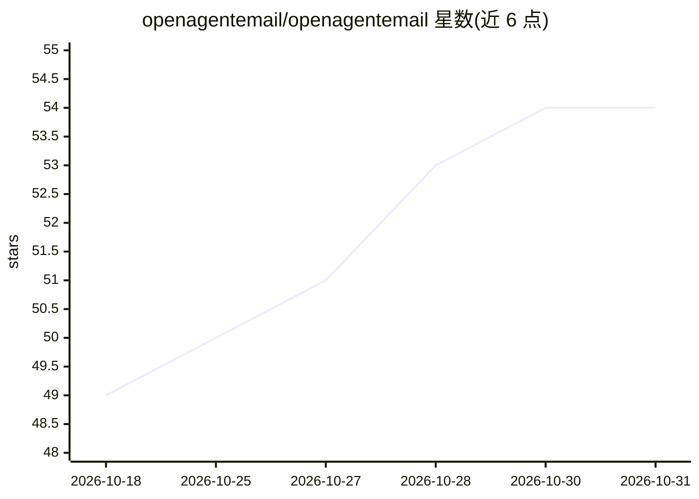

# openagentemail/openagentemail

⭐ 54 · TypeScript · Apache-2.0 · 推送 2026-10-28 · [GitHub](https://github.com/openagentemail/openagentemail) · [官网](https://openagent.email) · 组织维护 · 中文 README

**AI agent 间自托管邮件与任务交接基础设施**

为运行在不同终端/设备上的 AI agent 提供可自托管的通信与任务交接层：在自有域名上发放带身份令牌的 agent 地址，收发邮件并提取 OTP 验证码与链接，支持带状态历史的结构化任务线程、审批记录、通知与 webhook。通过 REST、HTTP MCP 与 stdio MCP 包装器暴露操作，可选任务租约提供认领/续约/释放。部署经 npx 引导式 setup CLI 完成，可选捆绑邮件服务器（Docker Compose）或 API-only（对接既有 IMAP/SMTP 提供商）两种后端，提供 Web 仪表盘查看邮件、任务与身份。明确边界：不做自动 worker 选择、审批不执行动作。

## 筛选速览

| 维度 | 判定 | 备注 |
|---|---|---|
| AI 角色 | `ai-ecosystem` | LLM/agent 周边工具 |
| 许可风险 | `permissive` | Apache-2.0 |
| 部署形态 | `self-host` | docker 或自建部署 |
| 模型依赖 | — | README 未给出锁定关系 |
| 硬件要求 | — | 无带数字的原话,不猜 |
| 安装摩擦 | `low` | 无编译、无系统依赖或容器化 |
| 成熟度 | — | 结构信号不足 |

## 能力要点

- 在托管域名上发放带独立身份令牌的 agent 地址（catch-all 邮箱上的逻辑身份）
- 结构化任务线程：命名接收者、状态历史、父子链接与结构化结果
- REST / HTTP MCP / stdio MCP 三种接口暴露，MCP 客户端需 Node.js 20+
- 两种部署后端：捆绑邮件服务器栈或对接既有 IMAP/SMTP 提供商的 API-only 模式

## 适用场景

- 让不同终端或设备上的 agent 通过邮件地址互相发送和跟踪任务
- 给 agent 配置邮箱以接收邮件并自动提取 OTP 验证码和链接
- 在仪表盘中审查 agent 之间的邮件、任务状态与审批记录

## 场景标签

`多智能体` · 领域:Agent 开发

## 证据(README 行号)

> L6:  Self-hosted email, task threads, approvals, and webhooks over MCP and REST —for the agents you already use.
> L77: REST, HTTP MCP and the stdio MCP wrapper expose these operations. Optional task

## 星数曲线

2026-10-18 49 → 2026-10-31 54（+5）

---
*卡片 v1 · prompt 1.4 · 生成 2026-10-24 · 置信度 high · 依据 README sha `302612e7e53e` · [字段定义](../../DATASET.md)*
