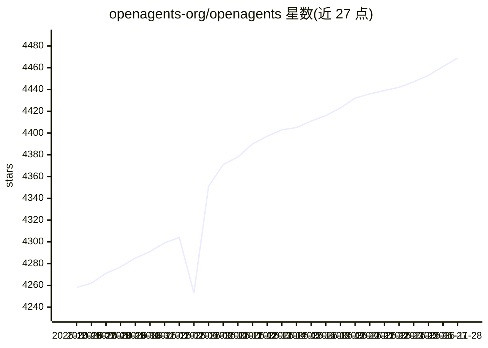

# openagents-org/openagents

⭐ 4,469 · TypeScript · Apache-2.0 · 推送 2026-11-27 · [GitHub](https://github.com/openagents-org/openagents) · [官网](https://openagents.org) · 组织维护

**多人协作运行 AI coding agent 的开源工作区**

开源工作区，把用户已在使用的 Claude Code、Codex 等 coding agent 汇聚到同一环境中：以线程形式与 agent 协作、共享浏览器查看 agent 操作、发布前进行审批，并提供 Routine 定时任务、Issue/Workflow、Knowledge 存储与移动端（iOS/Android）查看。接入方式包括托管工作区或自托管，通过 agn CLI 连接本地/服务器上的 agent 或 Cloud Agents，另提供 Python SDK 与 npm 包构建多 agent 网络。

## 筛选速览

| 维度 | 判定 | 备注 |
|---|---|---|
| AI 角色 | `ai-ecosystem` | LLM/agent 周边工具 |
| 许可风险 | `permissive` | Apache-2.0 |
| 部署形态 | `library` | 以包/库形式分发 |
| 模型依赖 | — | README 未给出锁定关系 |
| 硬件要求 | — | 无带数字的原话,不猜 |
| 安装摩擦 | `low` | 无编译、无系统依赖或容器化 |
| 成熟度 | — | 结构信号不足 |

## 能力要点

- 以线程协作、共享浏览器、发布前审批的工作区机制
- Routine 定时任务与带 Draft/Review/Publish 步骤的实验性 Workflow
- agn CLI 配对连接本地或服务器上的 agent，支持导入既有会话
- Python SDK 与 npm 包用于构建多 agent 网络与运行时集成

## 适用场景

- 团队与多个 coding agent 在同一工作区协作开发
- 将定时检查类请求交给 agent 以 Routine 方式执行
- 在手机上跟进 agent 的测试结果并分配失败项
- 自托管工作区供团队内部使用

## 场景标签

`编码 Agent` `多智能体` · 领域:Agent 开发

## 证据(README 行号)

> L3: # OpenAgents Workspace — the collaboration OS for people and AI agents
> L89: Use the OpenAgents Launcher to connect AI coding agents running on your computer or a server. Cloud agents can join
> L112: |Manage agents from a script or integrate an agent runtime|Agent connector · npm package · Runtime adapters|

## 星数曲线

2026-10-26 4,258 → 2026-11-28 4,469（+211）

---
*卡片 v1 · prompt 1.4 · 生成 2026-11-28 · 置信度 high · 依据 README sha `ae4bb7b69fc0` · [字段定义](../../DATASET.md)*
