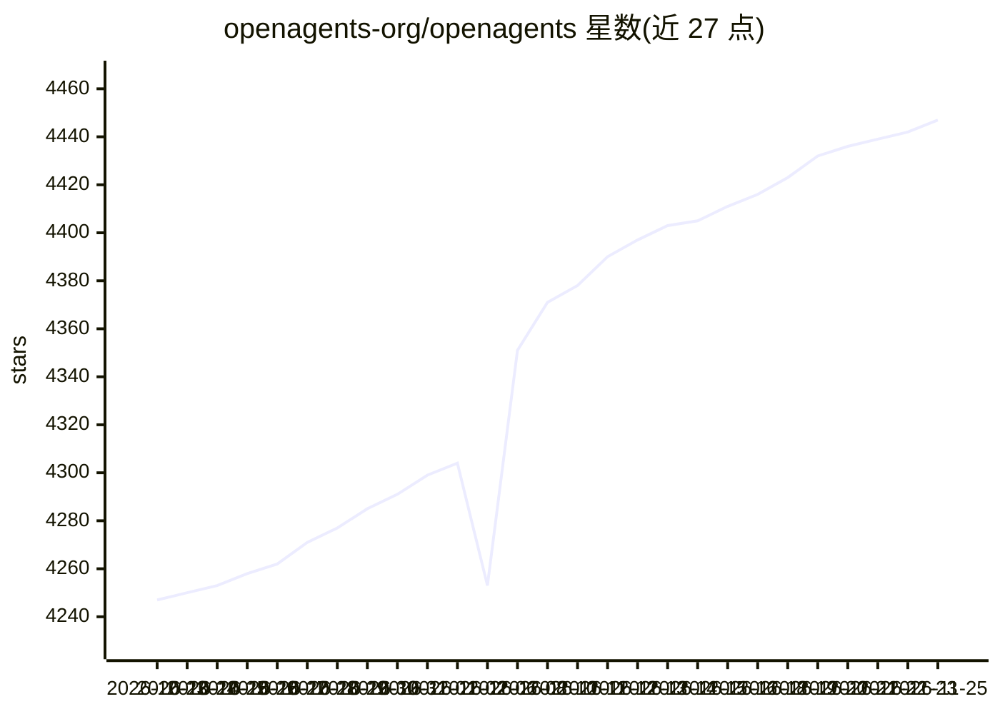

# openagents-org/openagents

⭐ 4,447 · TypeScript · Apache-2.0 · 推送 2026-11-24 · [GitHub](https://github.com/openagents-org/openagents) · [官网](https://openagents.org) · 组织维护

**为多 AI agent 提供统一工作区：连接、协作与混编团队**

OpenAgents Workspace 是一个面向 AI agent 的协作工作区：通过 CLI（agn 命令）或桌面应用安装、配置并连接 26 种 agent 到同一个工作区 URL，agent 间共享线程、文件与浏览器上下文。v1.1 支持人与 agent 混合团队，提供按角色路由任务、审批卡片、Issues 跟踪、共享文件与本地服务隧道公开。默认私有、按需共享，可自托管或使用托管服务，采用 Apache 2.0 许可。

## 筛选速览

| 维度 | 判定 | 备注 |
|---|---|---|
| AI 角色 | `ai-ecosystem` | LLM/agent 周边工具 |
| 许可风险 | `permissive` | Apache-2.0 |
| 部署形态 | `library` | 以包/库形式分发 |
| 模型依赖 | — | README 未给出锁定关系 |
| 硬件要求 | — | 无带数字的原话,不猜 |
| 安装摩擦 | `low` | 无编译、无系统依赖或容器化 |
| 成熟度 | — | 结构信号不足 |

## 能力要点

- CLI 与桌面应用安装并连接 26 种 agent 到统一工作区
- 人与 agent 混合团队：@mention 指派、按角色路由 doer/reviewer、审批卡片
- 共享线程、文件与浏览器，本地服务可一键隧道为公开 URL
- Apache 2.0 开源，支持自托管或托管服务

## 适用场景

- 把分布在多台机器上的 agent 汇总到一个工作区统一管理
- 让营销、基础设施等不同角色的 agent 与人类同事在同一线程协作
- 部署、花钱、删数据等操作前要求 agent 请求人工审批

## 场景标签

`多智能体` · 领域:Agent 开发

## 证据(README 行号)

> L33: Then run the launcher (`agn`) to open the interactive dashboard for managing AI coding agents.
> L89: - **Any agent, one workspace** — connect Claude Code, Codex CLI, OpenClaw, Cursor, Kiro, Qwen Code, or any of 25+ s
> L102: The Launcher installs, configures, and connects 26 agents (25 rows below; Qoder ships two editions).

## 星数曲线

2026-10-23 4,247 → 2026-11-25 4,447（+200）

---
*卡片 v1 · prompt 1.4 · 生成 2026-11-22 · 置信度 mid · 依据 README sha `59cd8ff8ec05` · [字段定义](../../DATASET.md)*
