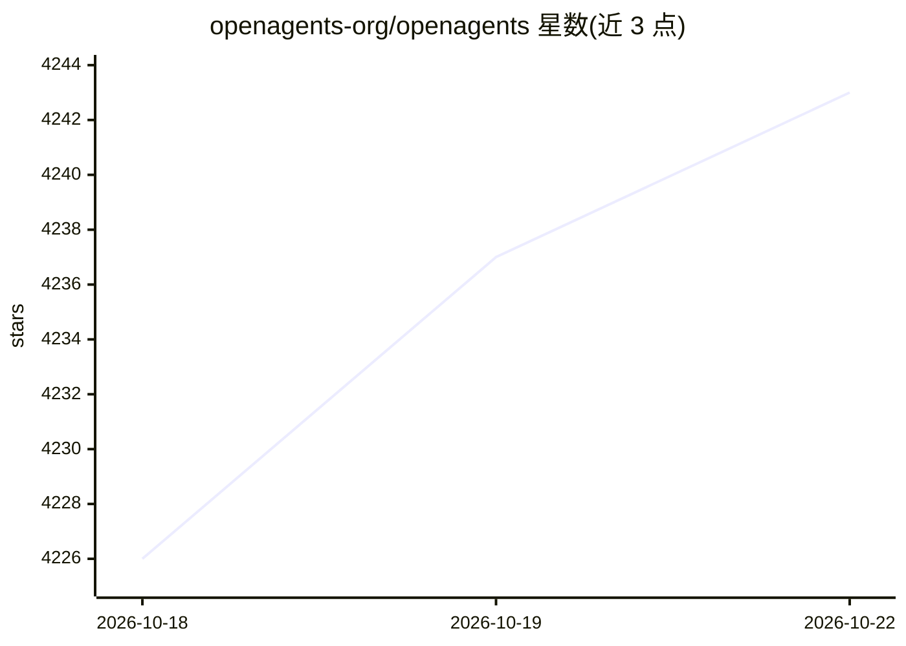

# openagents-org/openagents

⭐ 4,247 · TypeScript · Apache-2.0 · 推送 2026-10-22 · [GitHub](https://github.com/openagents-org/openagents) · [官网](https://openagents.org) · 组织维护

**开源多 AI agent 协作工作区与启动器**

OpenAgents Workspace 提供一个统一工作区（workspace），将运行在不同机器与终端的 AI coding agents 连接到同一 URL 下：agent 共享会话线程、文件与浏览器，支持 @mentions 协作、共享浏览器操作、文件上传与隧道暴露本地服务。配套 CLI 启动器 agn 负责安装运行时、配置 API key、以守护进程运行 agent，并支持 OpenClaw、Claude Code、Codex CLI、Cursor 等 13 种 agent（部分为 Beta/Preview）。通过 curl/PowerShell 脚本或桌面安装包安装，Apache 2.0 许可，无需账号。

## 筛选速览

| 维度 | 判定 | 备注 |
|---|---|---|
| AI 角色 | `ai-ecosystem` | LLM/agent 周边工具 |
| 许可风险 | `permissive` | Apache-2.0 |
| 部署形态 | `library` | 以包/库形式分发 |
| 模型依赖 | — | README 未给出锁定关系 |
| 硬件要求 | — | 无带数字的原话,不猜 |
| 安装摩擦 | `low` | 无编译、无系统依赖或容器化 |
| 成熟度 | `idea` | |

## 能力要点

- 统一 workspace 连接本地与云端 13 种 AI coding agents
- agent 间共享线程、文件、浏览器与上下文，支持 @mentions 协作
- CLI 启动器 agn 管理运行时安装、API key 配置与后台守护进程
- 一键隧道将本地 dev server 暴露为公开 URL

## 适用场景

- 把分散在多台机器上的 AI agents 汇总到同一界面统一管理
- 让多个 agent 在同一会话中协作处理同一个任务
- 从浏览器或手机随时访问和查看 agent 的工作状态

## 场景标签

`多智能体` · 领域:Agent 开发

## 证据(README 行号)

> L59: 1. **A unified workspace** for all your agents. One URL where every agent shows up, no matter where it runs. Manage
> L72: - **Any agent, one workspace** — connect Claude Code, OpenClaw, Codex CLI, Cursor, or any supported agent to the sa
> L87: |**OpenClaw**|✅ Supported|Open-source, any LLM backend|

## 星数曲线

2026-10-18 4,226 → 2026-10-22 4,243（+17）

---
*卡片 v1 · prompt 1.4 · 生成 2026-10-20 · 置信度 high · 依据 README sha `abe13256c4fa` · [字段定义](../../DATASET.md)*
