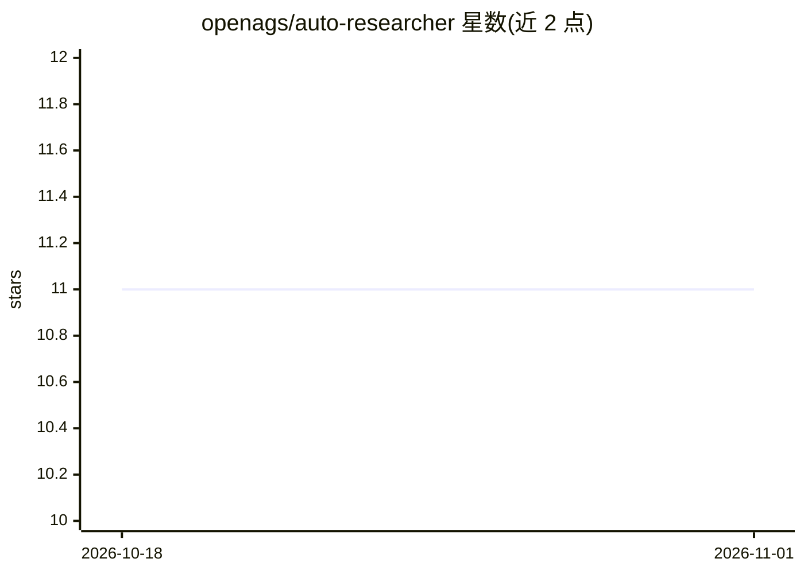

# openags/auto-researcher

⭐ 11 · TypeScript · MIT · 推送 2026-04-27 · [GitHub](https://github.com/openags/auto-researcher) · [官网](https://openags.com/) · 组织维护 · 中文 README

**自主科学研究框架：AI agent 团队端到端完成从文献到论文**

OpenAGS 是开源 TypeScript/Node.js 框架，编排一组 AI agent 协作完成科研全流程：文献综述、假说生成、实验、论文撰写与同行评审。提供 Electron 桌面应用（含集成 LaTeX 编辑器）与浏览器服务器两种使用方式，通过源码 clone 后以 pnpm 构建运行。CLI agent 后端支持 Claude Code、Codex、Cursor、Gemini CLI。TeX Live 与 Docker 为可选依赖，分别用于 LaTeX 编译和沙箱化实验；另有可选的 Rust CLI。

## 筛选速览

| 维度 | 判定 | 备注 |
|---|---|---|
| AI 角色 | `ai-native` | 本体是模型或模型工具 |
| 许可风险 | `permissive` | MIT |
| 部署形态 | `library` | 以包/库形式分发 |
| 模型依赖 | locked-api |  |
| 硬件要求 | — | 无带数字的原话,不猜 |
| 安装摩擦 | `medium` | 含编译或系统依赖之一 |
| 成熟度 | — | 结构信号不足 |

## 能力要点

- 多 agent 协作覆盖文献综述到论文评审的完整研究生命周期
- Electron 桌面应用与浏览器服务器两种运行模式
- 支持 Claude Code / Codex / Cursor / Gemini CLI 四种 agent 后端，含会话恢复
- 可选 Docker 沙箱化实验与 Rust CLI

## 适用场景

- 让 AI agent 团队自主执行从文献调研到成稿的科研流程
- 在带 LaTeX 编辑器的桌面工作区中管理研究项目
- 对比不同 CLI agent 后端执行研究任务

## 场景标签

`多智能体` `科研工具` · 领域:Agent 开发

## 证据(README 行号)

> L15: OpenAGS orchestrates a team of AI agents that collaborate across the full research lifecycle — literature review, h
> L5: An open-source framework for fully autonomous scientific research — from literature review to manuscript writing.

## 星数曲线

2026-10-18 11 → 2026-11-01 11（+0）

---
*卡片 v1 · prompt 1.4 · 生成 2026-11-01 · 置信度 low · 依据 README sha `2e1ef8cba120` · [字段定义](../../DATASET.md)*
