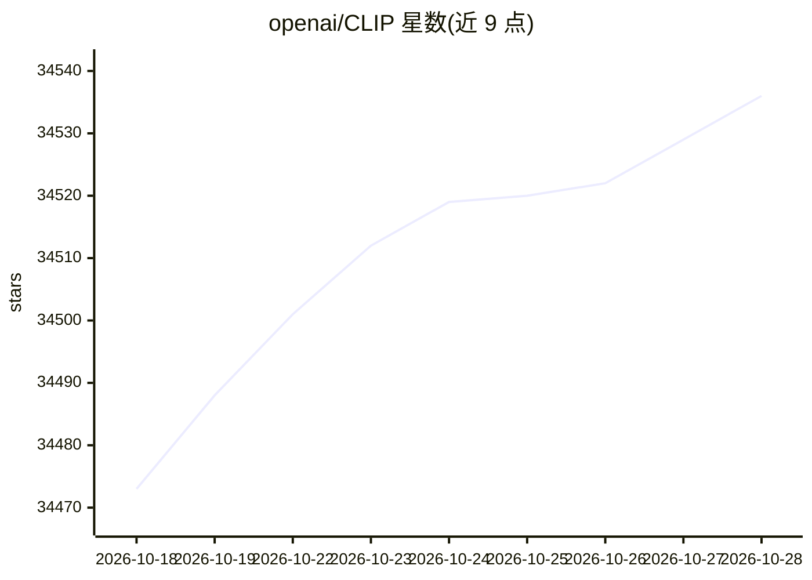

# openai/CLIP

⭐ 34,536 · Jupyter Notebook · MIT · 推送 2026-03-25 · [GitHub](https://github.com/openai/CLIP) · 组织维护

**研究者的图像-文本对比预训练模型库**

OpenAI 发布的 CLIP（Contrastive Language-Image Pre-Training）神经网络，在大量（图像, 文本）对上训练，可用自然语言指令在给定图像时预测最相关的文本片段，README 称其在 ImageNet 零样本设置下达到 ResNet50 的性能水平。以 Python 包形式发布，提供 clip.load、clip.tokenize、encode_image、encode_text 等 API，附零样本预测与线性探测（配合 scikit-learn）两个示例，另提供 Blog、Paper、Model Card 与 Colab 链接。

## 筛选速览

| 维度 | 判定 | 备注 |
|---|---|---|
| AI 角色 | `ai-native` | 本体是模型或模型工具 |
| 许可风险 | `permissive` | MIT |
| 部署形态 | `library` | 以包/库形式分发 |
| 模型依赖 | — | README 未给出锁定关系 |
| 硬件要求 | — | 无带数字的原话,不猜 |
| 安装摩擦 | `medium` | 含编译或系统依赖之一 |
| 成熟度 | — | 结构信号不足 |

## 动量与使用信号

- 维护:`declining` — 距上次 push 206.5 天,年发版 0,23 位贡献者
- 涨星:近 1 天 **+3**(自 20261016 起算)
- 安装:pypi 包 `ftfy` 月下载 13,881,709

## 能力要点

- 在图像-文本对上训练的对比预训练神经网络
- 提供 clip.load / clip.tokenize / encode_image / encode_text 等 API
- README 附零样本预测与线性探测评估两个示例
- 支持从本地 checkpoint 路径加载模型

## 适用场景

- 对图像做零样本文本标签预测
- 提取图像或文本的特征向量
- 在图像特征上做线性探测分类评估

## 场景标签

`多模态` · 领域:感知与多模态

## 证据(README 行号)

> L5: CLIP (Contrastive Language-Image Pre-Training) is a neural network trained on a variety of (image, text) pairs. It c
> L13: First, install PyTorch 1.7.1 (or later) and torchvision, as well as small additional dependencies, and then install
> L18: $ pip install git+https://github.com/openai/CLIP.git

## 星数曲线

2026-10-18 34,473 → 2026-10-28 34,536（+63）

---
*卡片 v1 · prompt 1.4 · 生成 2026-10-18 · 置信度 high · 依据 README sha `7e02b2d977cc` · [字段定义](../../DATASET.md)*
