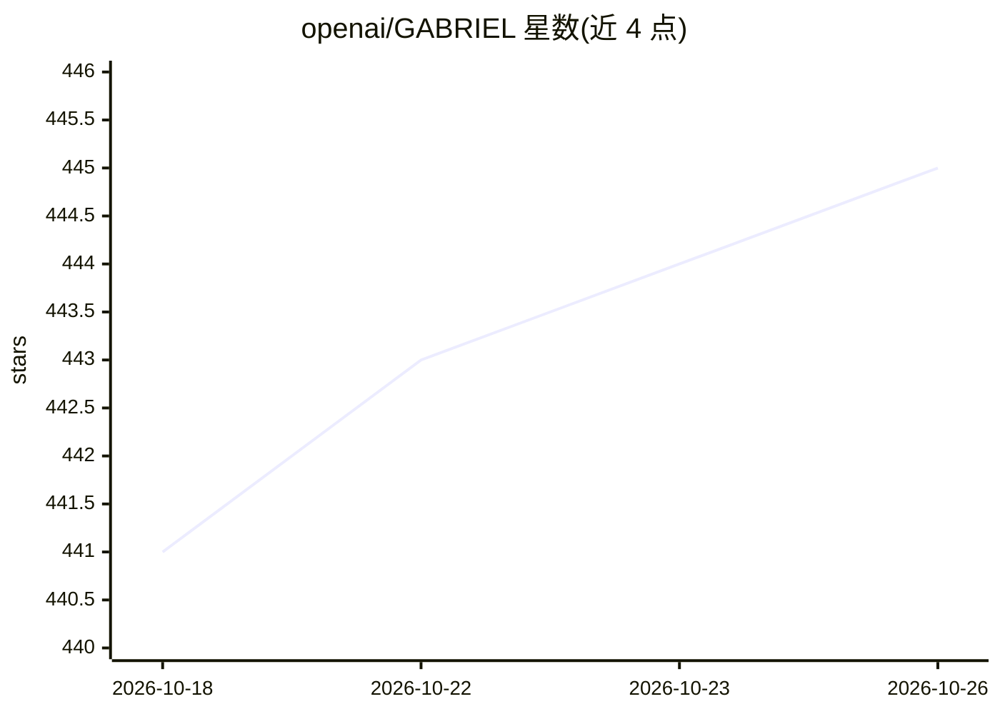

# openai/GABRIEL

⭐ 445 · Jupyter Notebook · Apache-2.0 · 推送 2026-07-15 · [GitHub](https://github.com/openai/GABRIEL) · 组织维护

**OpenAI 官方的 GPT 文本/图像/音频量化测量工具库**

面向社会科学家与数据科学家的 Python 库，通过 GPT API 将非结构化语料（文本、图像、音频、PDF）转为可分析数据集。提供评分（0-100）、成对排名、分类、事实抽取、数据清洗（合并/去重/PII 脱敏）等约 20 个函数，输出 pandas DataFrame。工程层面自动处理提示封装、数百并发、重试、断点续跑与原始响应日志，支持多模态与 web 搜索。需自备 OpenAI API key，含 Colab 教程笔记本与 AGENTS.md 编码代理指南。

## 筛选速览

| 维度 | 判定 | 备注 |
|---|---|---|
| AI 角色 | `ai-ecosystem` | LLM/agent 周边工具 |
| 许可风险 | `permissive` | Apache-2.0 |
| 部署形态 | `library` | 以包/库形式分发 |
| 模型依赖 | — | README 未给出锁定关系 |
| 硬件要求 | — | 无带数字的原话,不猜 |
| 安装摩擦 | `low` | 无编译、无系统依赖或容器化 |
| 成熟度 | — | 结构信号不足 |

## 能力要点

- 约 20 个测量/清洗函数（rate/rank/classify/extract/merge/deidentify 等），输出 DataFrame
- 自动并行（默认上限 650 并发）、重试、断续跑与原始响应审计日志
- 支持 text/image/audio/pdf/web 多种模态及 web_search 上下文获取
- 提供 Colab 教程笔记本与面向编码代理的 AGENTS.md 操作指南

## 适用场景

- 对演讲、访谈、推文等大规模语料做属性评分与分类编码
- 用自然语言条件筛选或模糊合并两个产品/职位目录
- 发布语料前替换 PII 为一致的假名以保护隐私

## 场景标签

`数据分析` · 领域:效率与自动化

## 证据(README 行号)

> L3: **GABRIEL** (Generalized Attribute Based Ratings Information Extraction Library) turns messy qualitative corpora int
> L27: - 🧠 **Human-level comprehension on demand** – express the attribute the way you would brief a human coder; GABRIEL 
> L29: - ⚙️ **Operational tooling** – automatic parallelism (hundreds of concurrent calls), resumable runs, raw response l

## 星数曲线

2026-10-18 441 → 2026-10-26 445（+4）

---
*卡片 v1 · prompt 1.4 · 生成 2026-10-21 · 置信度 high · 依据 README sha `26fdc9ba1c81` · [字段定义](../../DATASET.md)*
