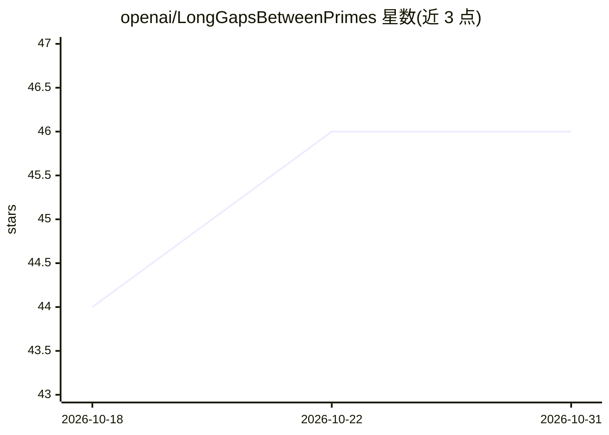

# openai/LongGapsBetweenPrimes

⭐ 46 · Lean · Apache-2.0 · 推送 2026-09-03 · [GitHub](https://github.com/openai/LongGapsBetweenPrimes) · 组织维护

**素数长间隙定理的 Lean 4 形式化证明（OpenAI 论文）**

OpenAI 论文《Improved Long Gaps Between Primes》结果的 Lean 4 形式化仓库：证明对所有充分大的 X，连续素数最大间隙 G(X) 的对数型下界。基于 Lean 4.33.0、mathlib 与 Lake 构建，通过 lake 命令获取 mathlib 缓存并编译；另提供独立证明检查流程，需安装 landrun、lean4export、nanoda_bin 等外部工具后运行 comparator。面向形式化数学与定理验证研究者。

## 筛选速览

| 维度 | 判定 | 备注 |
|---|---|---|
| AI 角色 | `ai-knowledge` | 知识聚合/清单类 |
| 许可风险 | `permissive` | Apache-2.0 |
| 部署形态 | `None` |  |
| 模型依赖 | — | README 未给出锁定关系 |
| 硬件要求 | — | 无带数字的原话,不猜 |
| 安装摩擦 | `low` | 无编译、无系统依赖或容器化 |
| 成熟度 | — | 结构信号不足 |

## 能力要点

- 素数间隙下界定理的完整 Lean 4 形式化
- 基于 Lean 4.33.0 + mathlib + Lake 构建
- 提供独立证明检查流程（landrun/lean4export/nanoda_bin + comparator）

## 适用场景

- 验证素数长间隙论文结果的机器可检证明
- 作为形式化数论研究的参考实现
- 检查大型数学证明的独立复核流程示例

## 场景标签

 · 领域:数学/形式化验证

## 证据(README 行号)

> L3: This repository contains a Lean 4 formalization of the results presented in
> L11: We prove that, for all sufficiently large $X$,

## 星数曲线

2026-10-18 44 → 2026-10-31 46（+2）

---
*卡片 v1 · prompt 1.4 · 生成 2026-10-25 · 置信度 mid · 依据 README sha `681bf1f8d9f0` · [字段定义](../../DATASET.md)*
