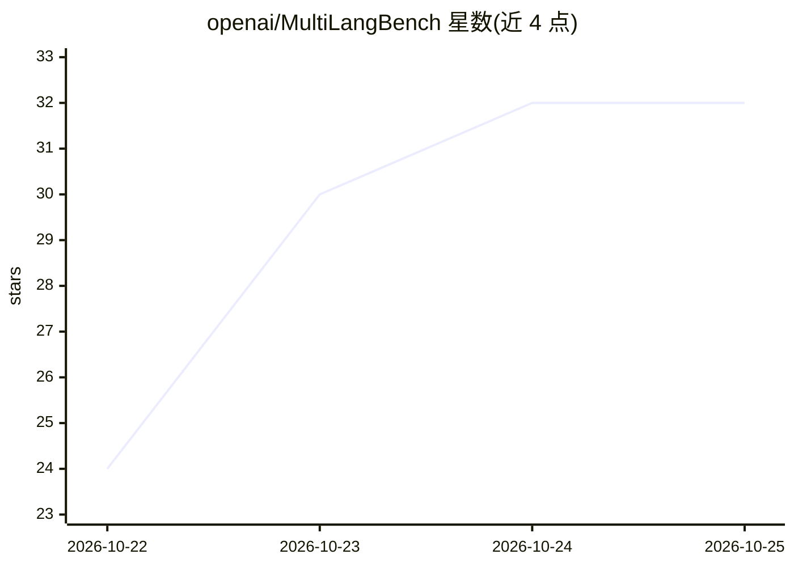

# openai/MultiLangBench

⭐ 35 · PLpgSQL · Apache-2.0 · 推送 2026-10-19 · [GitHub](https://github.com/openai/MultiLangBench) · 组织维护

**评测语言模型实现 SQLite 能力的多语言基准**

由 OpenAI 维护的 eval 基准：要求语言模型基于文档实现 SQLite 3.40.1，将其实现与真实 SQLite 对照评分。从 SQLite TCL Tests 的 51k 条测试转换出 24k 条三段式测试（初始数据库、用户查询、校验查询），常规评测建议使用 272 条前缀子集。评分为 (api_cost, test_pass_rate) 元组，非目标语言实现计 0 分。运行前需从环境中清除所有 SQLite 痕迹、下载官方文档进容器、禁止联网，单测试超时 60 秒判失败。Apache 2.0 许可。

## 筛选速览

| 维度 | 判定 | 备注 |
|---|---|---|
| AI 角色 | `ai-ecosystem` | LLM/agent 周边工具 |
| 许可风险 | `permissive` | Apache-2.0 |
| 部署形态 | `None` |  |
| 模型依赖 | — | README 未给出锁定关系 |
| 硬件要求 | — | 无带数字的原话,不猜 |
| 安装摩擦 | `low` | 无编译、无系统依赖或容器化 |
| 成熟度 | — | 结构信号不足 |

## 能力要点

- 从 SQLite TCL Tests 转换 24k 条三段式测试
- 评分为 (api_cost, test_pass_rate) 元组
- 常规评测使用 272 条前缀子集以控制成本
- 提供环境清理脚本 remove_sqlite.sh 与 expected_output.txt 校验文件

## 适用场景

- 评测语言模型按文档从零实现复杂软件的能力
- 比较多语言模型在大型代码实现任务上的成本与通过率
- 校验自建评测跑分器的正确性

## 场景标签

`模型评测` · 领域:评测与运维

## 证据(README 行号)

> L3: This is an eval where a language model has to implement SQLite version 3.40.1. It is given the documentation, and it
> L12: The score on the eval is the tuple of (`api_cost`, `test_pass_rate`). If the model doesn't write the solution in th

## 星数曲线

2026-10-22 24 → 2026-10-25 32（+8）

---
*卡片 v1 · prompt 1.4 · 生成 2026-10-25 · 置信度 high · 依据 README sha `a71a15d8b2eb` · [字段定义](../../DATASET.md)*
