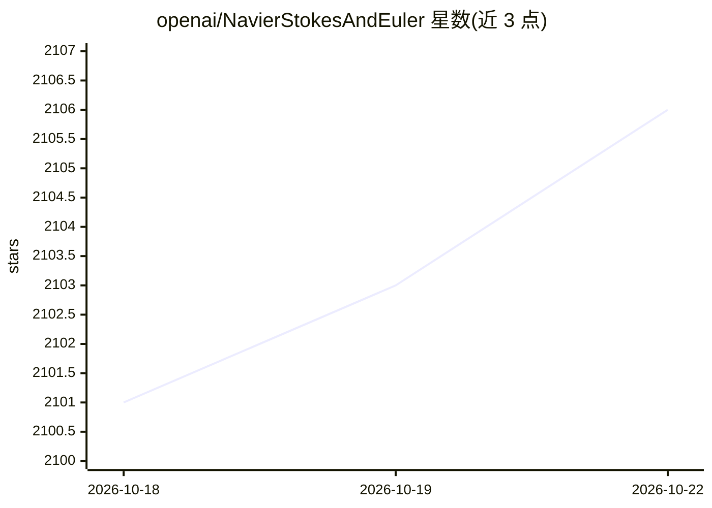

# openai/NavierStokesAndEuler

⭐ 2,107 · Lean · Apache-2.0 · 推送 2026-09-10 · [GitHub](https://github.com/openai/NavierStokesAndEuler) · 组织维护

**Navier–Stokes/Euler 有限时间爆破结果的 Lean 4 形式化证明**

OpenAI 发布的 Lean 4 形式化证明仓库，包含两篇论文的证书：Navier–Stokes 在全空间与周期环面上对应 Clay 千禧年问题 (C)(D) 的爆破结果，以及无粘 Euler 方程紧支撑初始速度的有限时间奇性形成。基于 Lean 4.34.0-rc2 与 Mathlib，通过 Lake 构建并可用 elan 获取 mathlib 缓存；另提供 Comparator 独立证明检查说明。面向形式化数学与定理证明研究者。

## 筛选速览

| 维度 | 判定 | 备注 |
|---|---|---|
| AI 角色 | `ai-knowledge` | 知识聚合/清单类 |
| 许可风险 | `permissive` | Apache-2.0 |
| 部署形态 | `None` |  |
| 模型依赖 | — | README 未给出锁定关系 |
| 硬件要求 | — | 无带数字的原话,不猜 |
| 安装摩擦 | `low` | 无编译、无系统依赖或容器化 |
| 成熟度 | — | 结构信号不足 |

## 能力要点

- Navier–Stokes 全空间与周期环面爆破定理的形式化
- Euler 方程有限时间奇性形成的形式化证明
- Lean 4 + Mathlib + Lake 构建，支持 mathlib 缓存
- 提供 Comparator 独立证明检查指引

## 适用场景

- 核验 OpenAI 有限元时间爆破论文的机器可检查证明
- 研究 Clay 千禧年问题 (C)(D) 的形式化结果
- 复用或扩展 Lean/Mathlib 中的 PDE 形式化方法

## 场景标签

`科研工具` · 领域:学习与行业

## 证据(README 行号)

> L3: This repository contains Lean 4 formalizations of the results presented in
> L35: The project uses Lean 4.34.0-rc2, Mathlib, and Lake. With

## 星数曲线

2026-10-18 2,101 → 2026-10-22 2,106（+5）

---
*卡片 v1 · prompt 1.4 · 生成 2026-10-21 · 置信度 high · 依据 README sha `bd7a8a4c17d4` · [字段定义](../../DATASET.md)*
