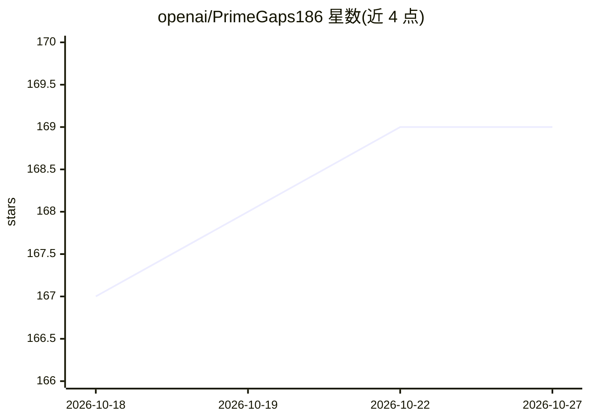

# openai/PrimeGaps186

⭐ 169 · Lean · Apache-2.0 · 推送 2026-09-02 · [GitHub](https://github.com/openai/PrimeGaps186) · 组织维护

**Lean 4 形式化素数间隙 ≤186 的条件性证明及数值证书**

OpenAI 名下仓库，包含素数间隙上界 liminf(p_{n+1}-p_n)≤186 的 Lean 4 形式化与 Python 数值证书。核心结果 DHL[40,2] 条件依赖于三个显式输入公理：两个 Deligne 型 Kloosterman 和估计（引用 Katz 与 Fouvry–Kowalski–Michel 文献）与 104+45+3 个物理积分界。Lean 结果为条件性：引用的数学估计与数值计算尚未在 Lean 中证明。数值证书用 Python 3.12、NumPy、python-flint 及定制 FLINT 3.6.0（未捆绑）从头重算，构建需 elan、Lean 4.34.0-rc2 与 Mathlib，验证曾运行于本地 Colima Linux VM。Apache 2.0 贡献条款。

## 筛选速览

| 维度 | 判定 | 备注 |
|---|---|---|
| AI 角色 | `ai-knowledge` | 知识聚合/清单类 |
| 许可风险 | `permissive` | Apache-2.0 |
| 部署形态 | `None` |  |
| 模型依赖 | — | README 未给出锁定关系 |
| 硬件要求 | — | 无带数字的原话,不猜 |
| 安装摩擦 | `low` | 无编译、无系统依赖或容器化 |
| 成熟度 | — | 结构信号不足 |

## 能力要点

- Lean 4 形式化 DHL[40,2] 并推出素数间隙 ≤186 的界
- 条件性：三个显式输入公理未在 Lean 中证明
- Python 数值证书从头重算全部物理积分界，成功运行输出 passed:true 回执
- 固定 Lean 4.34.0-rc2 与 Mathlib 依赖，lake build 可复现构建

## 适用场景

- 数学家审阅与复核素数间隙上界的条件性形式化证明
- 重跑数值证书核验积分界计算
- 作为 Lean/Mathlib 大型数论形式化工程的参考实例

## 场景标签

 · 领域:数学/形式化验证

## 证据(README 行号)

> L3: This repository contains a Lean 4 formalization of a prime-gap bound and a
> L4: Python numerical certificate. The Lean results remain **conditional on three explicit input axioms**;
> L78: `PrimeGap186.physical_integral_bounds` assumes 104 outer and 45 inner

## 星数曲线

2026-10-18 167 → 2026-10-27 169（+2）

---
*卡片 v1 · prompt 1.4 · 生成 2026-10-22 · 置信度 mid · 依据 README sha `c05d1bc4c575` · [字段定义](../../DATASET.md)*
