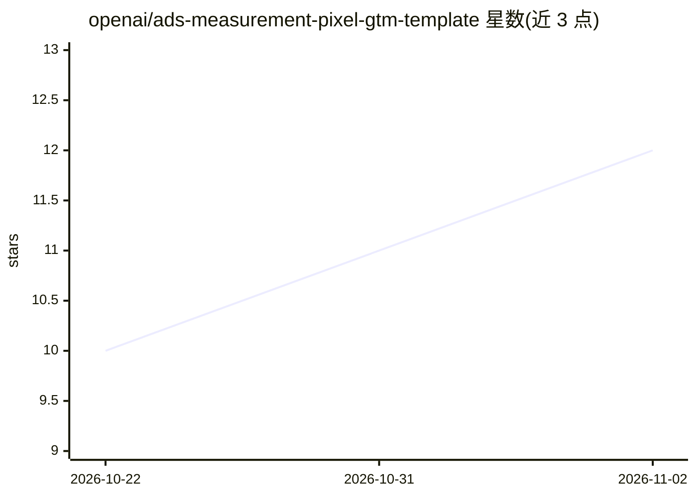

# openai/ads-measurement-pixel-gtm-template

⭐ 12 · Smarty · Apache-2.0 · 推送 2026-06-17 · [GitHub](https://github.com/openai/ads-measurement-pixel-gtm-template) · 组织维护

**OpenAI 广告度量像素的 GTM 标签模板：免代码安装配置**

Google Tag Manager 网页标签模板，供广告主安装和配置 OpenAI Ads Measurement Pixel，无需编写自定义 JavaScript。通过在 GTM 中导入 template.tpl 完成安装，配置时填入 Pixel ID、选择事件与触发器即可发布；支持可选的仅初始化基础标签与基于 Data Layer 变量的逐事件 opt-out。可在 GTM 预览模式中验证标签触发与事件发送，事件定义等细节见 OpenAI Ads 度量像素文档。

## 筛选速览

| 维度 | 判定 | 备注 |
|---|---|---|
| AI 角色 | `ai-ecosystem` | LLM/agent 周边工具 |
| 许可风险 | `permissive` | Apache-2.0 |
| 部署形态 | `None` |  |
| 模型依赖 | — | README 未给出锁定关系 |
| 硬件要求 | — | 无带数字的原话,不猜 |
| 安装摩擦 | `low` | 无编译、无系统依赖或容器化 |
| 成熟度 | — | 结构信号不足 |

## 能力要点

- 在 GTM 中导入 template.tpl 即可安装，无需自定义 JavaScript
- 每个待测量事件创建一个标签，配置 Pixel ID、事件字段与触发器
- 支持可选的仅初始化基础标签与逐事件 opt-out（Data Layer 变量）
- 可通过 GTM Preview 验证标签触发与事件发送

## 适用场景

- 我在 GTM 中给 OpenAI 广告度量像素埋点，不想手写 JS
- 为转化等广告事件配置像素并选择触发条件
- 按事件粒度控制度量 opt-out

## 场景标签

 · 领域:广告技术/网站埋点

## 证据(README 行号)

> L3: This repository contains the Google Tag Manager web tag template for the
> L4: OpenAI Ads Measurement Pixel. It lets advertisers install and configure the

## 星数曲线

2026-10-22 10 → 2026-11-02 12（+2）

---
*卡片 v1 · prompt 1.4 · 生成 2026-11-01 · 置信度 mid · 依据 README sha `e73e4468c0fc` · [字段定义](../../DATASET.md)*
