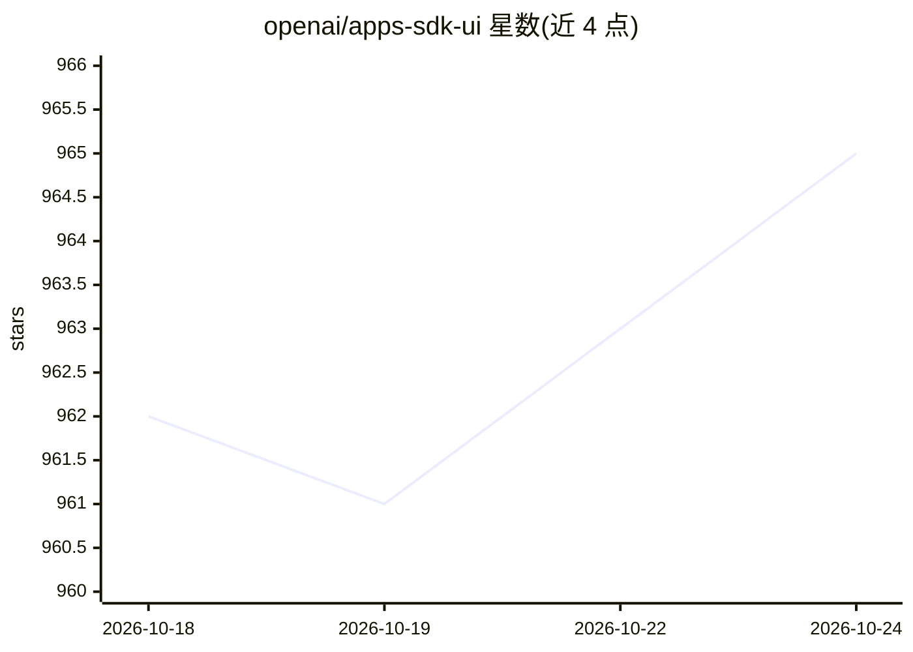

# openai/apps-sdk-ui

⭐ 965 · TypeScript · MIT · 推送 2026-05-20 · [GitHub](https://github.com/openai/apps-sdk-ui) · [官网](https://openai.github.io/apps-sdk-ui/) · 组织维护

**构建 ChatGPT 应用的 React 组件库与设计系统**

OpenAI 维护的轻量级设计系统，面向使用 Apps SDK 开发 ChatGPT 应用的前端开发者：提供 Tailwind 4 集成的设计令牌（颜色/排版/间距/阴影等）、基于 Radix 原语的无障碍 React 组件库，以及暗色模式、响应式布局和 ChatGPT 场景优化的工具函数。要求 React 18/19 与 Tailwind 4，通过 npm 安装后导入样式并可选配置 Provider 即可使用。MIT 许可。

## 筛选速览

| 维度 | 判定 | 备注 |
|---|---|---|
| AI 角色 | `ai-ecosystem` | LLM/agent 周边工具 |
| 许可风险 | `permissive` | MIT |
| 部署形态 | `library` | 以包/库形式分发 |
| 模型依赖 | — | README 未给出锁定关系 |
| 硬件要求 | — | 无带数字的原话,不猜 |
| 安装摩擦 | `low` | 无编译、无系统依赖或容器化 |
| 成熟度 | — | 结构信号不足 |

## 能力要点

- 覆盖颜色/排版/间距/阴影等的设计令牌体系
- Tailwind 4 预配置集成设计令牌
- 基于 Radix 原语的无障碍 React 组件库
- 暗色模式、响应式布局与 ChatGPT 优化行为的工具函数

## 适用场景

- 用 Apps SDK 开发界面风格一致的 ChatGPT 应用
- 为 ChatGPT 应用快速搭建暗色模式与响应式 UI
- 复用预配置的 Tailwind 设计令牌减少样式搭建工作

## 场景标签

 · 领域:前端开发/设计系统

## 证据(README 行号)

> L3: Apps SDK UI is a lightweight, accessible design system for building high-quality ChatGPT apps with the Apps SDK. It 
> L10: - **Utilities** for dark mode, responsive layouts, and ChatGPT-optimized behaviors.

## 星数曲线

2026-10-18 962 → 2026-10-24 965（+3）

---
*卡片 v1 · prompt 1.4 · 生成 2026-10-21 · 置信度 high · 依据 README sha `98867d78c434` · [字段定义](../../DATASET.md)*
