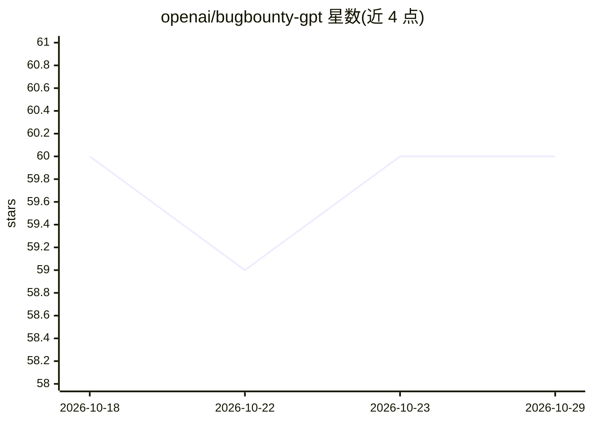

# openai/bugbounty-gpt

⭐ 60 · Python · MIT · 推送 2026-03-26 · [GitHub](https://github.com/openai/bugbounty-gpt) · 组织维护

**用 GPT 自动分类与处理 BugCrowd 漏洞赏金提交的系统**

面向 BugCrowd 漏洞赏金项目管理者的自动分诊工具：通过 BugCrowd API 拉取提交，调用 OpenAI 聊天模型（可配置如 gpt-4）按自定义类别对报告分类，并对指定类别自动关闭并回复模板响应，数据存储于 PostgreSQL（异步 asyncpg 驱动，alembic 管理迁移）。通过 Docker/Docker Compose 或 python -m bugbounty_gpt 本地运行；需配置 config.yaml 与 BUGCROWD_API_KEY、OPENAI_API_KEY 等环境变量；Docker Compose 提供临时数据库用于测试。

## 筛选速览

| 维度 | 判定 | 备注 |
|---|---|---|
| AI 角色 | `ai-native` | 本体是模型或模型工具 |
| 许可风险 | `permissive` | MIT |
| 部署形态 | `self-host` | docker 或自建部署 |
| 模型依赖 | — | README 未给出锁定关系 |
| 硬件要求 | — | 无带数字的原话,不猜 |
| 安装摩擦 | `low` | 无编译、无系统依赖或容器化 |
| 成熟度 | — | 结构信号不足 |

## 能力要点

- OpenAI 模型驱动的提交自动分类与模板自动回复
- 类别体系由 config.yaml 配置，含默认类别兜底
- PostgreSQL + alembic 存储，docker-compose 临时数据库支持配置快速测试
- 可直接 Docker 运行或 python -m bugbounty_gpt 本地运行

## 适用场景

- 漏洞赏金平台运营方自动分诊海量提交
- 按类别自动回复与关闭范围外的报告
- 为特定 BugCrowd 项目定制分类规则与响应模板

## 场景标签

`网络安全` · 领域:学习与行业

## 证据(README 行号)

> L3: This project is a system designed to manage, classify, and process BugCrowd submissions using OpenAI, and a Postgres
> L30: - `openai_model`: Chat model used for the OpenAI integration, e.g. `"gpt-4"`.

## 星数曲线

2026-10-18 60 → 2026-10-29 60（+0）

---
*卡片 v1 · prompt 1.4 · 生成 2026-10-24 · 置信度 high · 依据 README sha `b0d7d47ab40d` · [字段定义](../../DATASET.md)*
