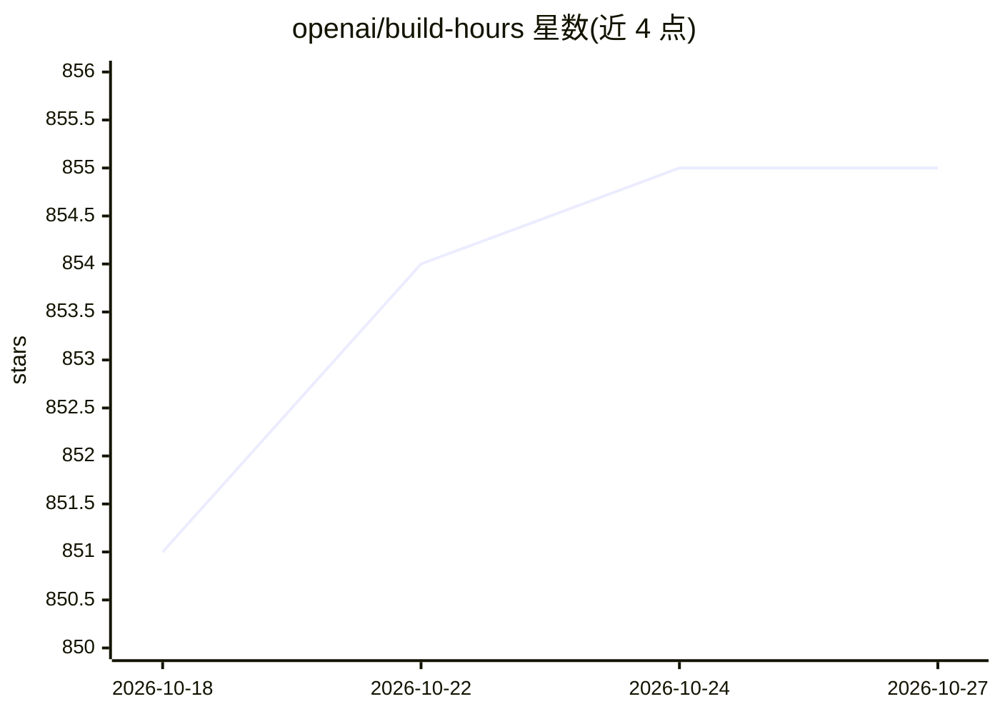

# openai/build-hours

⭐ 855 · TypeScript · MIT · 推送 2026-07-24 · [GitHub](https://github.com/openai/build-hours) · 组织维护

**OpenAI Build Hours 线上系列课程的配套代码仓库**

存放 OpenAI Build Hours 线上直播系列（由技术团队主讲，每小时一节）中动手演示所用代码的仓库。该系列围绕最新产品发布进行讲解，包含代码仓库演示、最佳实践与现场问答；用户可在 Build Hours 主页报名后续场次并观看按需回放。仓库本身仅共享课程演示代码，未提供安装说明或运行入口。

## 筛选速览

| 维度 | 判定 | 备注 |
|---|---|---|
| AI 角色 | `ai-knowledge` | 知识聚合/清单类 |
| 许可风险 | `permissive` | MIT |
| 部署形态 | `None` |  |
| 模型依赖 | — | README 未给出锁定关系 |
| 硬件要求 | — | 无带数字的原话,不猜 |
| 安装摩擦 | `low` | 无编译、无系统依赖或容器化 |
| 成熟度 | — | 结构信号不足 |

## 能力要点

- 收录 Build Hours 线上系列各场次的动手演示代码
- 系列内容围绕 OpenAI 最新产品发布与最佳实践
- 配套按需回放与现场问答

## 适用场景

- 跟随 Build Hours 课程复现演示代码
- 查阅 OpenAI 新产品发布的实践示例

## 场景标签

`教程课程` · 领域:学习与行业

## 证据(README 行号)

> L3: OpenAI Build Hours is a live virtual series led by our technical team to help you build with the latest product rele

## 星数曲线

2026-10-18 851 → 2026-10-27 855（+4）

---
*卡片 v1 · prompt 1.4 · 生成 2026-10-21 · 置信度 mid · 依据 README sha `fb41697300cf` · [字段定义](../../DATASET.md)*
