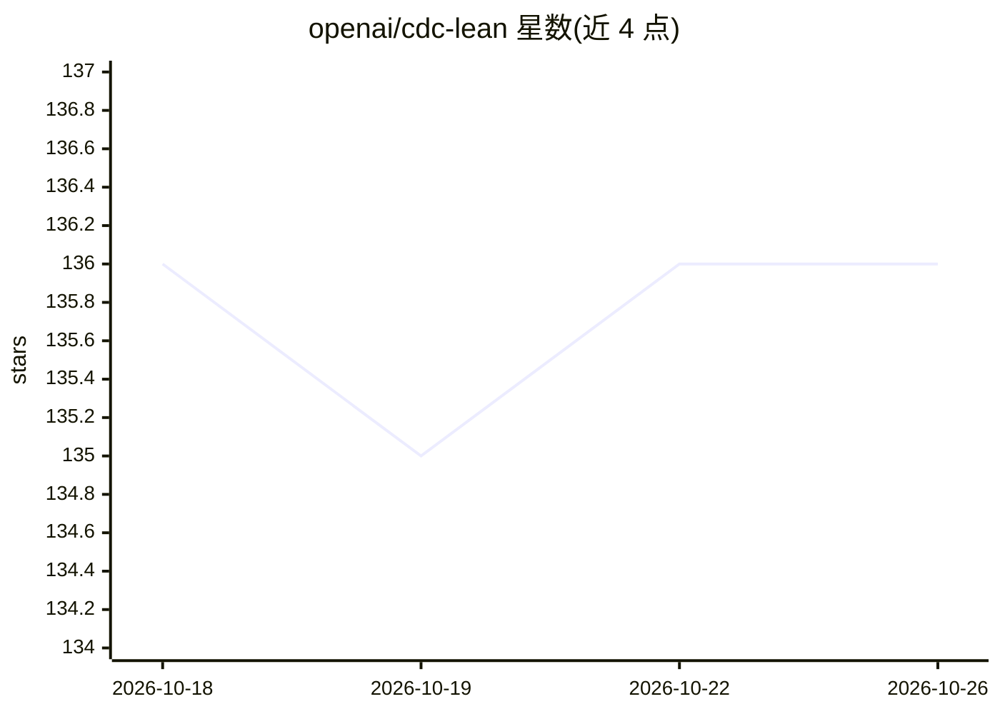

# openai/cdc-lean

⭐ 136 · Lean · 推送 2026-07-09 · [GitHub](https://github.com/openai/cdc-lean) · 组织维护

**Lean 形式化验证图论中的无环双覆盖定理**

用 Lean 4 形式化并机器检验有限无环无桥多重图的无条件圈双覆盖（CDC）定理：基于已形式化的 Jaeger–Kilpatrick 八流定理构造非零 Γ=(ZMod 2)^3 流，再转换为圈双覆盖。Lean 固定于 v4.31.0，Mathlib 固定于指定修订。面向形式化数学研究者，需安装 elan 后经 lake 构建与缓存编译；提供 Audit.lean 与正则扫描验证证明不含 sorry/axiom 等未证内容，审计仅允许 propext、Classical.choice 与 Quot.sound。

## 筛选速览

| 维度 | 判定 | 备注 |
|---|---|---|
| AI 角色 | `ai-knowledge` | 知识聚合/清单类 |
| 许可风险 | `none` | — |
| 部署形态 | `None` |  |
| 模型依赖 | — | README 未给出锁定关系 |
| 硬件要求 | — | 无带数字的原话,不猜 |
| 安装摩擦 | `low` | 无编译、无系统依赖或容器化 |
| 成熟度 | — | 结构信号不足 |

## 能力要点

- 端点定理 CDCLean.cycleDoubleCover_of_bridgeless 的完整 Lean 证明
- 由 Jaeger–Kilpatrick 八流定理构造非零 (ZMod 2)^3 流并转换为圈双覆盖
- 提供审计脚本核验无 sorry/axiom/native_decide

## 适用场景

- 核验圈双覆盖定理的形式化证明
- 作为图论形式化研究的教学或研究参考

## 场景标签

 · 领域:数学/形式化验证

## 证据(README 行号)

> L3: This project kernel-checks an unconditional cycle double cover theorem for finite loopless
> L4: bridgeless multigraphs. The endpoint is `CDCLean.cycleDoubleCover_of_bridgeless` in

## 星数曲线

2026-10-18 136 → 2026-10-26 136（+0）

---
*卡片 v1 · prompt 1.4 · 生成 2026-10-22 · 置信度 high · 依据 README sha `78019ac9bede` · [字段定义](../../DATASET.md)*
