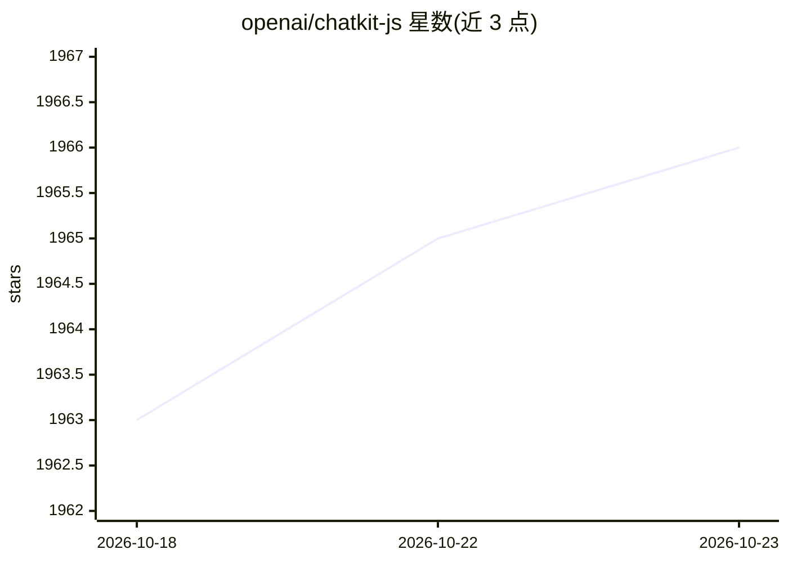

# openai/chatkit-js

⭐ 1,966 · TypeScript · Apache-2.0 · 推送 2026-07-31 · [GitHub](https://github.com/openai/chatkit-js) · [官网](https://openai.github.io/chatkit-js/) · 组织维护

**OpenAI 的 React 聊天界面框架：快速嵌入 AI 对话体验**

面向开发者的框架无关、即插即用 AI 聊天界面框架。将 ChatKit 组件嵌入应用并提供 client token 即可运行，内置响应流式输出、工具与工作流可视化、富交互组件、文件/图片附件处理、会话与消息管理、来源标注与实体标签等功能。接入流程：服务端用 OpenAI SDK 生成 client token，安装 @openai/chatkit-react，加载 CDN 脚本后渲染组件。提供起步模板与示例仓库，采用 Apache 2.0 许可。

## 筛选速览

| 维度 | 判定 | 备注 |
|---|---|---|
| AI 角色 | `ai-ecosystem` | LLM/agent 周边工具 |
| 许可风险 | `permissive` | Apache-2.0 |
| 部署形态 | `library` | 以包/库形式分发 |
| 模型依赖 | — | README 未给出锁定关系 |
| 硬件要求 | — | 无带数字的原话,不猜 |
| 安装摩擦 | `low` | 无编译、无系统依赖或容器化 |
| 成熟度 | — | 结构信号不足 |

## 能力要点

- 内置响应流式输出与 chain-of-thought 过程可视化
- 聊天内渲染富交互组件与附件（文件/图片）处理
- 来源标注与实体标签提供引用透明度
- 框架无关、drop-in 组件接入，需服务端生成 client token

## 适用场景

- 为应用快速添加生产可用的 AI 聊天界面
- 可视化 agent 工具调用与工作流过程
- 构建带附件上传与来源引用的对话产品

## 场景标签

`聊天机器人` · 领域:对话与助手

## 证据(README 行号)

> L1: ChatKit is a batteries-included framework for building high-quality, AI-powered chat experiences. It’s designed for 
> L17: ChatKit is a framework-agnostic, drop-in chat solution.

## 星数曲线

2026-10-18 1,963 → 2026-10-23 1,966（+3）

---
*卡片 v1 · prompt 1.4 · 生成 2026-10-21 · 置信度 high · 依据 README sha `5cf5d5ab3cb9` · [字段定义](../../DATASET.md)*
