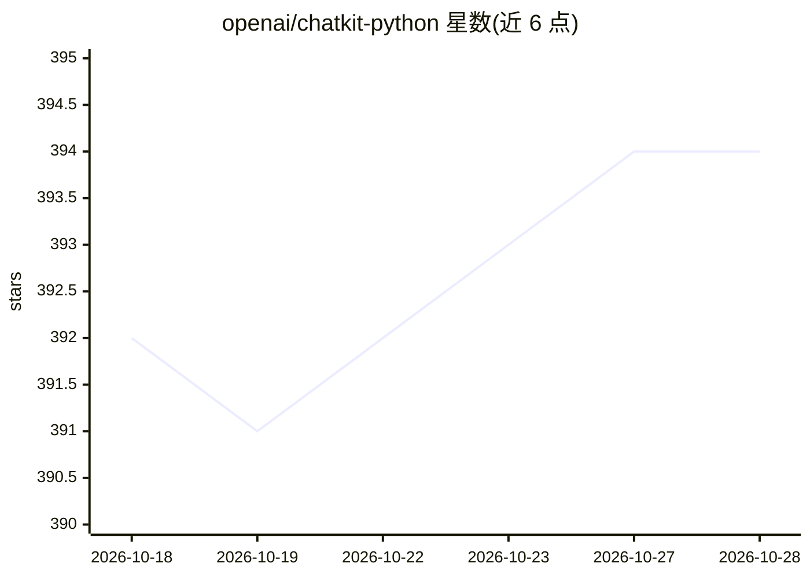

# openai/chatkit-python

⭐ 394 · Python · Apache-2.0 · 推送 2026-05-19 · [GitHub](https://github.com/openai/chatkit-python) · [官网](https://openai.github.io/chatkit-python/) · 组织维护

**OpenAI 的 Python 聊天界面工具包（README 仅含许可证信息）**

该项目为 openai 组织下的 chatkit-python 仓库，README 可见内容仅有许可证声明：项目采用 Apache License 2.0 许可。README 中未提供功能描述、安装方式、使用示例或依赖信息，无法从可见内容核实其具体能力。依据仓库名称与所属组织推测其为面向开发者的聊天界面相关工具包，但此点不在 README 可验证范围内。

## 筛选速览

| 维度 | 判定 | 备注 |
|---|---|---|
| AI 角色 | `ai-ecosystem` | LLM/agent 周边工具 |
| 许可风险 | `permissive` | Apache-2.0 |
| 部署形态 | `None` |  |
| 模型依赖 | — | README 未给出锁定关系 |
| 硬件要求 | — | 无带数字的原话,不猜 |
| 安装摩擦 | `low` | 无编译、无系统依赖或容器化 |
| 成熟度 | — | 结构信号不足 |

## 能力要点

- Apache License 2.0 许可
- 由 openai 组织维护

## 适用场景

- 无法从 README 可见内容确定适用场景

## 场景标签

 · 领域:开发工具

## 证据(README 行号)

> L1: ## License
> L2: This project is licensed under the Apache License 2.0.

## 星数曲线

2026-10-18 392 → 2026-10-28 394（+2）

---
*卡片 v1 · prompt 1.4 · 生成 2026-10-21 · 置信度 low · 依据 README sha `941e829a09b0` · [字段定义](../../DATASET.md)*
