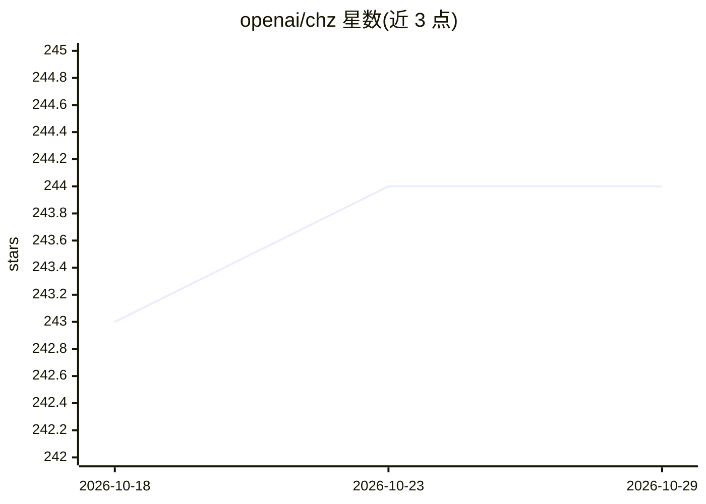

# openai/chz

⭐ 244 · Python · MIT · 推送 2025-11-24 · [GitHub](https://github.com/openai/chz) · 组织维护

**Python 配置管理库：声明式对象模型与命令行解析**

由 OpenAI 名下仓库维护的 Python 配置管理库，在 PyPI 发布。功能包括声明式对象模型、不可变性、校验、类型检查、命令行解析、可发现性、部分应用、预设/共享配置以及序列化与反序列化。面向需要在应用中统一管理配置并从命令行读取配置的 Python 开发者，以库形式安装使用，README 未展示 AI 相关能力。

## 筛选速览

| 维度 | 判定 | 备注 |
|---|---|---|
| AI 角色 | `ai-enhanced` | 去掉 AI 部分产品仍成立 |
| 许可风险 | `permissive` | MIT |
| 部署形态 | `library` | 以包/库形式分发 |
| 模型依赖 | — | README 未给出锁定关系 |
| 硬件要求 | — | 无带数字的原话,不猜 |
| 安装摩擦 | `low` | 无编译、无系统依赖或容器化 |
| 成熟度 | — | 结构信号不足 |

## 能力要点

- 声明式对象模型与不可变配置对象
- 校验、类型检查与命令行解析
- 预设/共享配置与序列化、反序列化

## 适用场景

- 在 Python 应用中用声明式模型管理配置
- 从命令行读取并校验配置参数
- 通过预设共享团队通用配置

## 场景标签

 · 领域:开发者工具/配置管理

## 证据(README 行号)

> L5: `chz` helps you manage configuration, particularly from the command line.
> L7: `chz` is available on PyPI.

## 星数曲线

2026-10-18 243 → 2026-10-29 244（+1）

---
*卡片 v1 · prompt 1.4 · 生成 2026-10-22 · 置信度 low · 依据 README sha `3872f55fcd04` · [字段定义](../../DATASET.md)*
