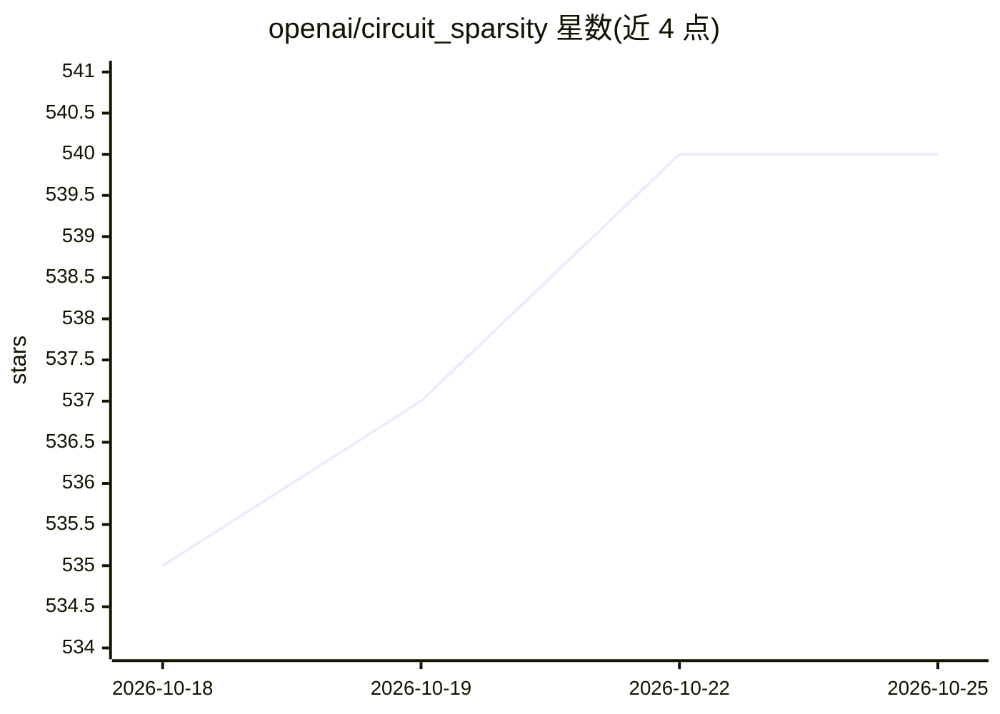

# openai/circuit_sparsity

⭐ 540 · Python · Apache-2.0 · 推送 2026-09-04 · [GitHub](https://github.com/openai/circuit_sparsity) · [官网](https://openai.com/index/understanding-neural-networks-through-sparse-circuits/) · 组织维护

**稀疏电路模型的可视化与推理工具：Gao et al. 2025 论文配套**

OpenAI 发布的 Gao et al. 2025 论文配套代码：提供轻量 GPT 实现（GPTConfig/GPT/load_model）用于在 CPU/GPU 上运行模型前向推理，并带 Streamlit 交互式仪表盘，可按模型、数据集、剪枝 sweep 与节点预算 k 检查剪枝得到的任务特定电路，含节点消融差值与激活预览；数据从 openaipublic 下载并本地缓存。论文所用全部模型（118M/475M 等）随项目发布。

## 筛选速览

| 维度 | 判定 | 备注 |
|---|---|---|
| AI 角色 | `ai-native` | 本体是模型或模型工具 |
| 许可风险 | `permissive` | Apache-2.0 |
| 部署形态 | `library` | 以包/库形式分发 |
| 模型依赖 | — | README 未给出锁定关系 |
| 硬件要求 | — | 无带数字的原话,不猜 |
| 安装摩擦 | `medium` | 含编译或系统依赖之一 |
| 成熟度 | — | 结构信号不足 |

## 能力要点

- 轻量 GPT 实现，支持 CPU/GPU 推理与 hook 记录
- Streamlit 仪表盘交互检查电路掩码、激活与消融差值
- 发布论文全部模型与多种剪枝 sweep（CARBS 各版本）
- 模型与可视化数据托管于 openaipublic 并本地缓存

## 适用场景

- 复现并检查论文中的稀疏电路剪枝结果
- 对任务特定电路做节点消融与激活可视化分析
- 用发布的 checkpoint 运行 GPT 前向推理做后续实验

## 场景标签

`科研工具` · 领域:学习与行业

## 证据(README 行号)

> L3: Tools for inspecting sparse circuit models from Gao et al. 2025. Provides code
> L35: - `GPTConfig` / `GPT`: lightweight GPT implementation suitable for CPU/GPU

## 星数曲线

2026-10-18 535 → 2026-10-25 540（+5）

---
*卡片 v1 · prompt 1.4 · 生成 2026-10-21 · 置信度 high · 依据 README sha `c490f6a6407c` · [字段定义](../../DATASET.md)*
