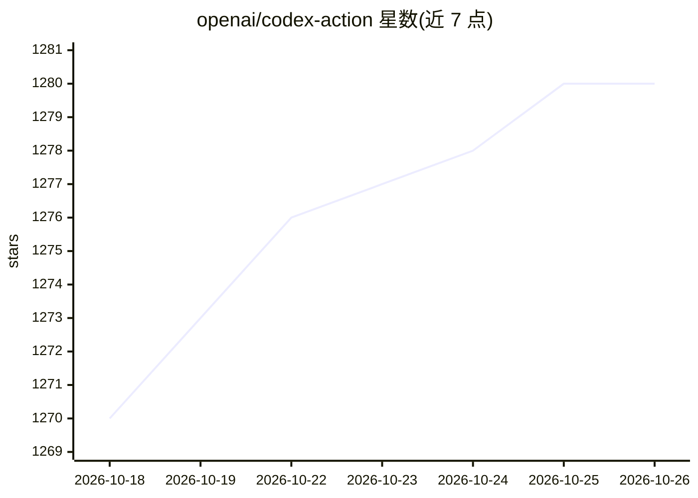

# openai/codex-action

⭐ 1,280 · JavaScript · Apache-2.0 · 推送 2026-10-20 · [GitHub](https://github.com/openai/codex-action) · 组织维护

**在 GitHub Actions 中以受限权限运行 Codex CLI 的官方 Action**

OpenAI 维护的 GitHub Action：在 Actions 工作流中安装 Codex CLI 并通过安全代理接入 Responses API，让 Codex 在 CI 内执行代码审查、PR 处理等任务。提供 prompt/prompt-file、输出 schema、permission profile（workspace/read-only，beta）与 codex-args 等输入；安全策略含 drop-sudo（默认）、unprivileged-user、read-only、unsafe 四档，Linux/macOS 全支持，Windows 仅 unsafe。支持 Azure OpenAI 端点覆盖，需以 GitHub Secrets 提供 API key。

## 筛选速览

| 维度 | 判定 | 备注 |
|---|---|---|
| AI 角色 | `ai-ecosystem` | LLM/agent 周边工具 |
| 许可风险 | `permissive` | Apache-2.0 |
| 部署形态 | `None` |  |
| 模型依赖 | locked-api |  |
| 硬件要求 | — | 无带数字的原话,不猜 |
| 安装摩擦 | `low` | 无编译、无系统依赖或容器化 |
| 成熟度 | — | 结构信号不足 |

## 能力要点

- 自动安装 Codex CLI 并经安全代理接入 Responses API
- 四档 safety-strategy（drop-sudo/unprivileged-user/read-only/unsafe）与 permission profile 权限控制
- 支持 Azure OpenAI 自定义 Responses 端点
- final-message 输出可回传工作流，供 PR 评论等用途

## 适用场景

- 自建 PR 代码审查机器人并把结果评论到 PR
- 在 CI 中以受控权限让 Codex 执行仓库内任务
- 用 Azure OpenAI 托管模型运行 Codex 工作流

## 场景标签

`代码审查` `编码 Agent` · 领域:编码与开发

## 证据(README 行号)

> L3: Run Codex from a GitHub Actions workflow while keeping tight control over the privileges available to Codex. This ac
> L5: Users must provide an API key for their chosen provider (for example, `OPENAI_API_KEY` or `AZURE_OPENAI_API_KEY` if 

## 星数曲线

2026-10-18 1,270 → 2026-10-26 1,280（+10）

---
*卡片 v1 · prompt 1.4 · 生成 2026-10-21 · 置信度 high · 依据 README sha `fde8e059894d` · [字段定义](../../DATASET.md)*
