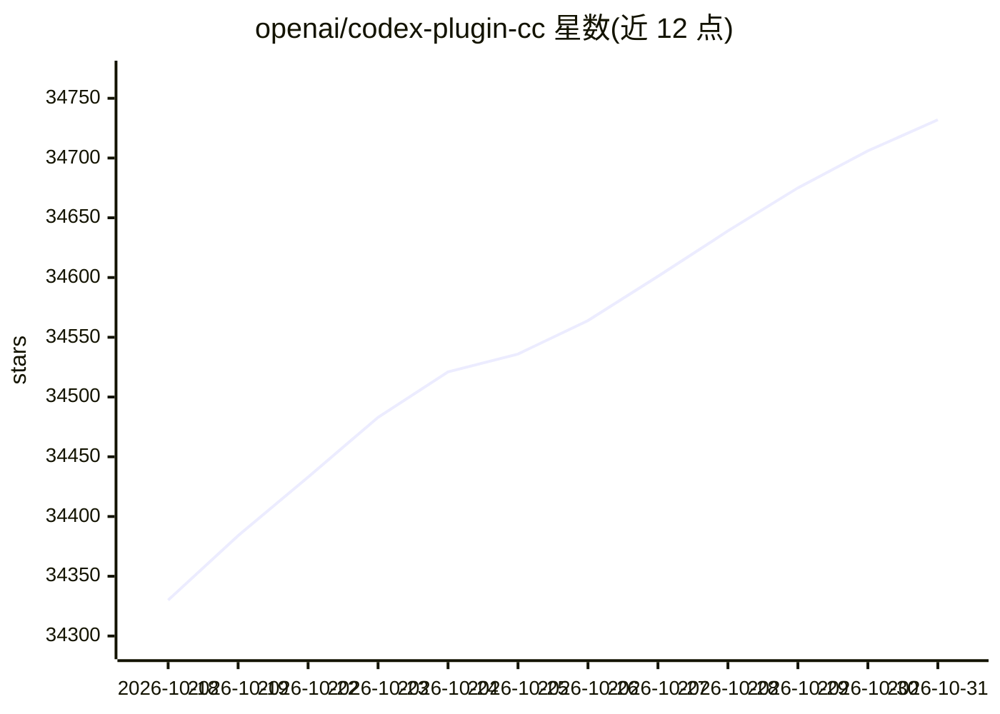

# openai/codex-plugin-cc

⭐ 34,732 · JavaScript · Apache-2.0 · 推送 2026-07-08 · [GitHub](https://github.com/openai/codex-plugin-cc) · 组织维护

**让 Claude Code 用户调用 Codex 做代码审查与任务委派的插件**

OpenAI 官方发布的 Claude Code 插件，通过 /plugin marketplace 安装后，在 Claude Code 工作流内提供 /codex:review、/codex:adversarial-review 等斜杠命令调用 Codex 做只读代码审查，并提供 /codex:rescue、/codex:transfer 等命令把任务委派给 Codex、迁移会话上下文、管理后台作业。插件封装本地 Codex CLI 与 app server，复用已有安装、认证与 config.toml 配置；需要 ChatGPT 订阅或 OpenAI API key，以及 Node.js 18.18+。可选启用 review gate 在 Claude 停止前执行 Codex 审查。

## 筛选速览

| 维度 | 判定 | 备注 |
|---|---|---|
| AI 角色 | `ai-ecosystem` | LLM/agent 周边工具 |
| 许可风险 | `permissive` | Apache-2.0 |
| 部署形态 | `library` | 以包/库形式分发 |
| 模型依赖 | — | README 未给出锁定关系 |
| 硬件要求 | — | 无带数字的原话,不猜 |
| 安装摩擦 | `low` | 无编译、无系统依赖或容器化 |
| 成熟度 | — | 结构信号不足 |

## 动量与使用信号

- 维护:`maintenance` — 距上次 push 102.3 天,年发版 7,13 位贡献者
- 涨星:近 1 天 **+50**(自 20261016 起算)
- 安装:npm 包 `@openai/codex` 月下载 93,017,254
- 平台:— · 协议:OPENAI-API

## 能力要点

- /codex:review 只读审查与 /codex:adversarial-review 可定向质询审查
- /codex:rescue 通过子代理把调查、修 bug 等任务委派给 Codex
- /codex:transfer 把 Claude Code 会话迁移为 Codex 线程，可在 App/TUI 续接
- 复用本地 Codex CLI 的安装、认证与 config.toml 配置

## 适用场景

- 在 Claude Code 里对未提交改动或分支差异跑 Codex 代码审查
- 把调试、修测试等任务委派给 Codex 后台运行并查看进度
- 在 Claude Code 与 Codex 之间无缝续接同一会话上下文

## 场景标签

`代码审查` `编码 Agent` · 领域:编码与开发

## 证据(README 行号)

> L3: Use Codex from inside Claude Code for code reviews or to delegate tasks to Codex.
> L18: - **ChatGPT subscription (incl. Free) or OpenAI API key.**
> L269: The Codex plugin wraps the Codex app server. It uses the global `codex` binary installed in your environment and a

## 星数曲线

2026-10-18 34,330 → 2026-10-31 34,732（+402）

---
*卡片 v1 · prompt 1.4 · 生成 2026-10-18 · 置信度 high · 依据 README sha `34b2f6c57fe0` · [字段定义](../../DATASET.md)*
