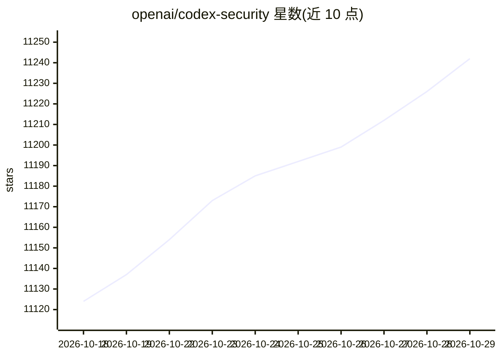

# openai/codex-security

⭐ 11,242 · TypeScript · Apache-2.0 · 推送 2026-10-28 · [GitHub](https://github.com/openai/codex-security) · [官网](https://developers.openai.com/codex/security) · 组织维护

**OpenAI 的代码安全漏洞扫描、验证与修复 CLI/SDK**

以 npm 包 @openai/codex-security 提供的命令行工具和 TypeScript SDK，面向在代码库中查找、验证并修复安全漏洞的开发者。支持仓库/路径/Git 变更扫描（并行深度扫描）、候选发现验证与补丁生成、SECURITY.md 草稿与威胁模型保存、GitHub 代码扫描告警导入、SARIF/JSON/CSV 导出、发布到 Linear 或 findings 服务，以及 GitHub Actions 与 Docker Compose 批量扫描。扫描可使用 OpenAI、Amazon Bedrock、OpenRouter、Fireworks AI 等多种模型提供方；本地 serve 命令与浏览器仪表盘已移除。需登录或 API key，部分请求需 Trusted Access 审批。

## 筛选速览

| 维度 | 判定 | 备注 |
|---|---|---|
| AI 角色 | `ai-native` | 本体是模型或模型工具 |
| 许可风险 | `permissive` | Apache-2.0 |
| 部署形态 | `self-host` | docker 或自建部署 |
| 模型依赖 | locked-api |  |
| 硬件要求 | — | 无带数字的原话,不猜 |
| 安装摩擦 | `low` | 无编译、无系统依赖或容器化 |
| 成熟度 | — | 结构信号不足 |

## 能力要点

- 仓库/路径/Git 变更扫描与并行深度扫描
- 候选发现验证、补丁生成与既有修复核验
- SECURITY.md 草稿生成与威胁模型导出
- 支持 GitHub Actions 定时/PR 扫描与 Docker Compose 批量扫描

## 适用场景

- 在 CI 中对仓库做定期或 PR 触发的安全扫描
- 验证安全发现、生成补丁并核验已有修复
- 为项目起草 SECURITY.md 政策并保存威胁模型

## 场景标签

`网络安全` `代码审查` · 领域:编码与开发

## 证据(README 行号)

> L3: `@openai/codex-security` is a CLI and TypeScript SDK for finding, validating, and
> L8: - Scan repositories, selected paths, or Git changes. Deep scans run parallel
> L203: Scans support OpenAI, Amazon Bedrock, OpenRouter, Fireworks AI, and Cheaper Inference. Bedrock uses

## 星数曲线

2026-10-18 11,124 → 2026-10-29 11,242（+118）

---
*卡片 v1 · prompt 1.4 · 生成 2026-10-20 · 置信度 high · 依据 README sha `b25adab7a6e4` · [字段定义](../../DATASET.md)*
