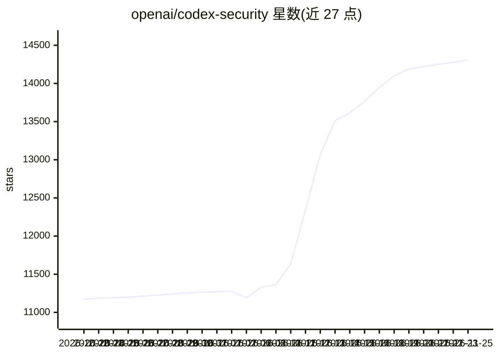

# openai/codex-security

⭐ 14,310 · TypeScript · Apache-2.0 · 推送 2026-11-24 · [GitHub](https://github.com/openai/codex-security) · [官网](https://developers.openai.com/codex/security) · 组织维护

**面向开发者扫描并修复代码安全漏洞的 CLI 与 SDK**

OpenAI 发布的 Codex Security CLI 与 TypeScript SDK，用于发现、验证与修复代码中的安全漏洞：支持扫描仓库、指定路径或 Git 变更，验证候选发现、生成补丁并核验已有修复，起草 SECURITY.md 与威胁模型，跟踪 Linear/Jira/GitHub 工单并导出 SARIF/JSON/CSV。可在 Codex 会话中作为插件使用，也可通过 CLI、GitHub Actions 或 Docker Compose 容器批量扫描。要求 Node.js 22.13.0+ 或 24.x/26.x 与 Python 3.10+，CI 需设置 API key；部分请求需 Trusted Access for Cyber。

## 筛选速览

| 维度 | 判定 | 备注 |
|---|---|---|
| AI 角色 | `ai-native` | 本体是模型或模型工具 |
| 许可风险 | `permissive` | Apache-2.0 |
| 部署形态 | `self-host` | docker 或自建部署 |
| 模型依赖 | — | README 未给出锁定关系 |
| 硬件要求 | — | 无带数字的原话,不猜 |
| 安装摩擦 | `low` | 无编译、无系统依赖或容器化 |
| 成熟度 | — | 结构信号不足 |

## 能力要点

- 扫描仓库/路径/Git 变更，Deep 扫描去重返回发现
- 验证候选发现、生成补丁、核验已有修复
- 导出 SARIF/JSON/CSV，跟踪 Linear/Jira/GitHub
- 提供 CLI、TypeScript SDK、GitHub Action 与容器批量扫描

## 适用场景

- 在 CI 中定期扫描仓库并输出 SARIF 报告
- 批量扫描多个仓库并汇总安全发现
- 为现有仓库起草与更新 SECURITY.md 策略
- 让 AI 生成漏洞补丁并核验修复是否有效

## 场景标签

`网络安全` · 领域:学习与行业

## 证据(README 行号)

> L3: Codex Security helps you find, investigate, and fix vulnerabilities in your code.
> L5: `@openai/codex-security` CLI and TypeScript SDK.
> L14: - Scan repositories, selected paths, or Git changes. Deep scans repeat Standard scans and return their deduplicated

## 星数曲线

2026-10-23 11,173 → 2026-11-25 14,310（+3,137）

---
*卡片 v1 · prompt 1.4 · 生成 2026-11-24 · 置信度 high · 依据 README sha `9aa6b484701f` · [字段定义](../../DATASET.md)*
