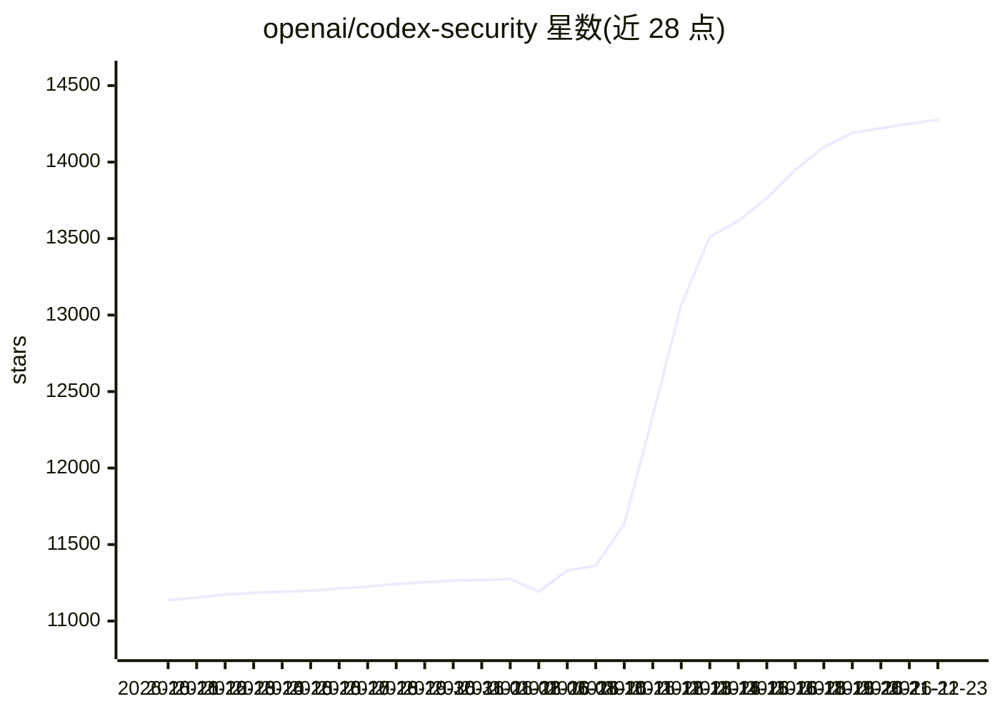

# openai/codex-security

⭐ 14,276 · TypeScript · Apache-2.0 · 推送 2026-11-22 · [GitHub](https://github.com/openai/codex-security) · [官网](https://developers.openai.com/codex/security) · 组织维护

**开发者的代码安全漏洞扫描/修复 CLI 与 SDK**

OpenAI 出品的 CLI 与 TypeScript SDK，用于发现、调查、验证并修复代码中的安全漏洞：可扫描整个仓库、指定路径或 Git 变更，支持 Standard/Deep 两种模式并去重结果；可验证候选发现、生成补丁、验证已有修复，起草 SECURITY.md 策略并保存威胁模型；发现可同步到 Linear/Jira/GitHub，导出 SARIF/JSON/CSV，或发布到 Codex Security Cloud。依赖 Node.js 22.13+/24/26 与 Python 3.10+，通过 npm 安装，另有 GitHub Action 与 Docker Compose 批量扫描方式；部分功能需 Trusted Access for Cyber。

## 筛选速览

| 维度 | 判定 | 备注 |
|---|---|---|
| AI 角色 | `ai-native` | 本体是模型或模型工具 |
| 许可风险 | `permissive` | Apache-2.0 |
| 部署形态 | `self-host` | docker 或自建部署 |
| 模型依赖 | locked-api |  |
| 硬件要求 | — | 无带数字的原话,不猜 |
| 安装摩擦 | `low` | 无编译、无系统依赖或容器化 |
| 成熟度 | — | 结构信号不足 |

## 能力要点

- 扫描仓库/路径/Git 变更，Deep 扫描对结果去重
- 验证候选发现、生成补丁并验证已有修复
- 起草 SECURITY.md 策略并导出威胁模型
- 支持 CI（GitHub Action）、容器化批量扫描与 SARIF/JSON/CSV 导出

## 适用场景

- 在终端扫描自己仓库的认证与授权类漏洞并生成补丁
- 用 GitHub Action 每周自动扫描并按严重度阈值检查 PR
- 把扫描发现同步到 Jira/Linear 跟踪修复
- 为多仓库应用执行可恢复的批量扫描

## 场景标签

`网络安全` · 领域:学习与行业

## 证据(README 行号)

> L3: Codex Security helps you find, investigate, and fix vulnerabilities in your code.
> L14: - Scan repositories, selected paths, or Git changes. Deep scans repeat Standard scans and return their deduplicated
> L65: For CI, set `OPENAI_API_KEY` or `CODEX_API_KEY` in the scan process's environment.

## 星数曲线

2026-10-21 11,137 → 2026-11-23 14,276（+3,139）

---
*卡片 v1 · prompt 1.4 · 生成 2026-11-22 · 置信度 high · 依据 README sha `539d8823cf36` · [字段定义](../../DATASET.md)*
