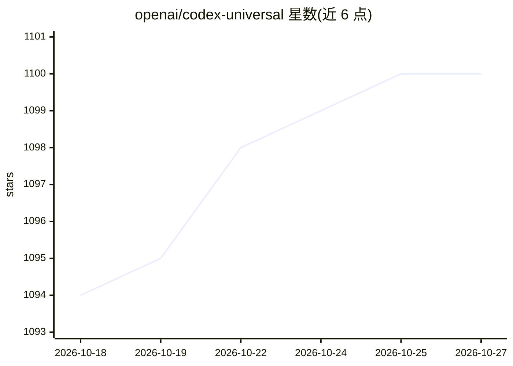

# openai/codex-universal

⭐ 1,100 · Dockerfile · 推送 2026-05-02 · [GitHub](https://github.com/openai/codex-universal) · 组织维护

**OpenAI Codex 环境基础 Docker 镜像的参考实现**

提供 OpenAI Codex 环境所用基础 Docker 镜像的参考实现，供开发者拉取并在本地运行，用于调试与自定义 Codex 环境；README 声明并非完全相同的环境。镜像构建覆盖 linux/amd64 与 linux/arm64，但官方仅运行 amd64 版本。内置 setup 脚本通过 CODEX_ENV_* 环境变量配置 Python、Node、Rust、Go、Swift、Ruby、PHP、Java 等语言运行时版本，并附带 bun、bazel、erlang、elixir 等预装包。

## 筛选速览

| 维度 | 判定 | 备注 |
|---|---|---|
| AI 角色 | `ai-ecosystem` | LLM/agent 周边工具 |
| 许可风险 | `none` | — |
| 部署形态 | `self-host` | docker 或自建部署 |
| 模型依赖 | — | README 未给出锁定关系 |
| 硬件要求 | — | 无带数字的原话,不猜 |
| 安装摩擦 | `low` | 无编译、无系统依赖或容器化 |
| 成熟度 | — | 结构信号不足 |

## 能力要点

- 镜像发布于 ghcr.io，支持 linux/amd64 与 linux/arm64
- 通过 CODEX_ENV_* 环境变量配置 8 类语言运行时的指定版本
- 预装 bun、bazel、erlang、elixir 等工具
- 提供近似 Codex setup 环境的 docker run 脚本示例

## 适用场景

- 本地复现 Codex 环境用于调试
- 以该镜像为基础构建自定义 Codex 开发环境
- 在统一容器内配置多语言运行时版本

## 场景标签

 · 领域:开发环境/容器镜像

## 证据(README 行号)

> L3: `codex-universal` is a reference implementation of the base Docker image available in OpenAI Codex.
> L5: This repository is intended to help developers cutomize environments in Codex, by providing a similar image that can

## 星数曲线

2026-10-18 1,094 → 2026-10-27 1,100（+6）

---
*卡片 v1 · prompt 1.4 · 生成 2026-10-21 · 置信度 high · 依据 README sha `3ce073d0de94` · [字段定义](../../DATASET.md)*
