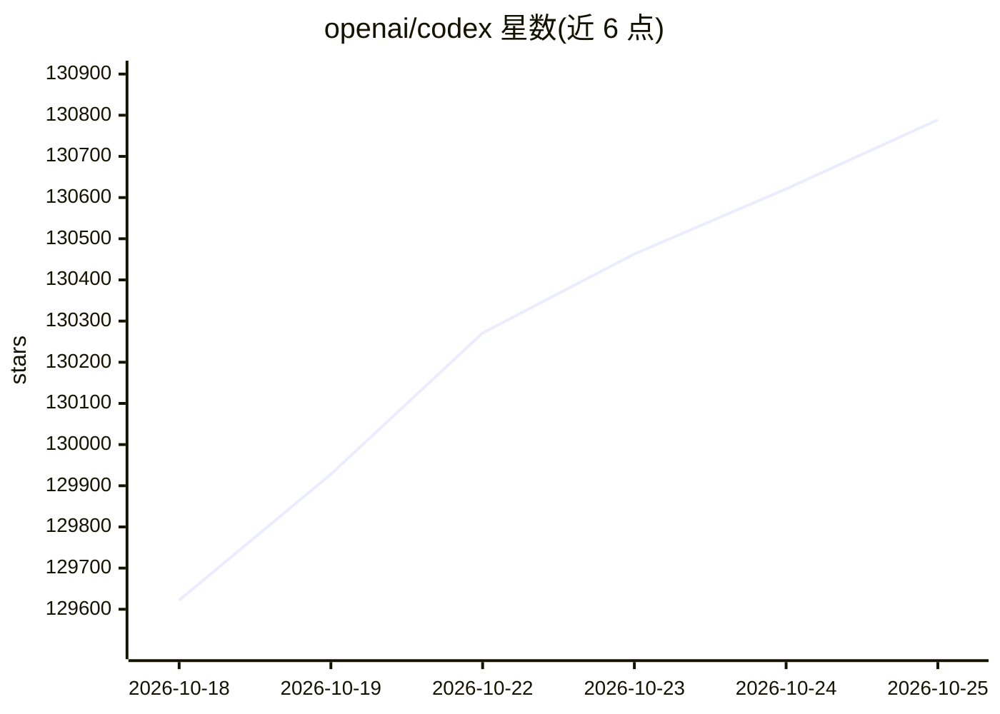

# openai/codex

⭐ 130,789 · Rust · Apache-2.0 · 推送 2026-10-23 · [GitHub](https://github.com/openai/codex) · 组织维护

**OpenAI 出品的终端内本地运行的编程 Agent**

Codex CLI 是 OpenAI 提供的命令行编程 Agent，在用户本地计算机上运行。安装方式覆盖 macOS/Linux 的 shell 脚本、Windows PowerShell 脚本，以及 npm、Homebrew 等包管理器，并提供各平台的预编译二进制下载（安装器默认从 releases.openai.com 下载，可回退或强制使用 GitHub Releases）。使用时可通过 ChatGPT 账号登录（Plus/Pro/Business/Edu/Enterprise 套餐），也可改用 API key（需额外设置）。另有 IDE 扩展、桌面应用（codex app）与云端版本 Codex Web。仓库采用 Apache-2.0 许可证。

## 筛选速览

| 维度 | 判定 | 备注 |
|---|---|---|
| AI 角色 | `ai-native` | 本体是模型或模型工具 |
| 许可风险 | `permissive` | Apache-2.0 |
| 部署形态 | `library` | 以包/库形式分发 |
| 模型依赖 | — | README 未给出锁定关系 |
| 硬件要求 | — | 无带数字的原话,不猜 |
| 安装摩擦 | `low` | 无编译、无系统依赖或容器化 |
| 成熟度 | — | 结构信号不足 |

## 动量与使用信号

- 维护:`active` — 距上次 push 1.1 天,年发版 100,478 位贡献者
- 涨星:近 1 天 **+150**(自 20261016 起算)
- 安装:npm 包 `@openai/codex` 月下载 93,017,254
- 平台:WINDOWS / MACOS / LINUX · 协议:—

## 能力要点

- macOS/Linux/Windows 一行命令安装脚本，另有 npm 与 Homebrew 渠道
- 提供 Apple Silicon/x86_64 与 Linux arm64/x86_64 预编译二进制
- 支持 ChatGPT 套餐登录或 API key 两种使用方式
- 配套 IDE 扩展、桌面应用与云端版本入口

## 适用场景

- 在终端中让 AI Agent 协助编写代码
- 配合 ChatGPT Plus/Pro 等套餐使用编程 Agent
- 在无 IDE 的命令行环境中运行 AI 编码工具

## 场景标签

`编码 Agent` · 领域:编码与开发

## 证据(README 行号)

> L1: Codex CLI is a coding agent from OpenAI that runs locally on your computer.
> L35: Codex CLI can also be installed via the following package managers:
> L75: This repository is licensed under the Apache-2.0 License.

## 星数曲线

2026-10-18 129,622 → 2026-10-25 130,789（+1,167）

---
*卡片 v1 · prompt 1.4 · 生成 2026-10-18 · 置信度 high · 依据 README sha `3af8635ac24f` · [字段定义](../../DATASET.md)*
