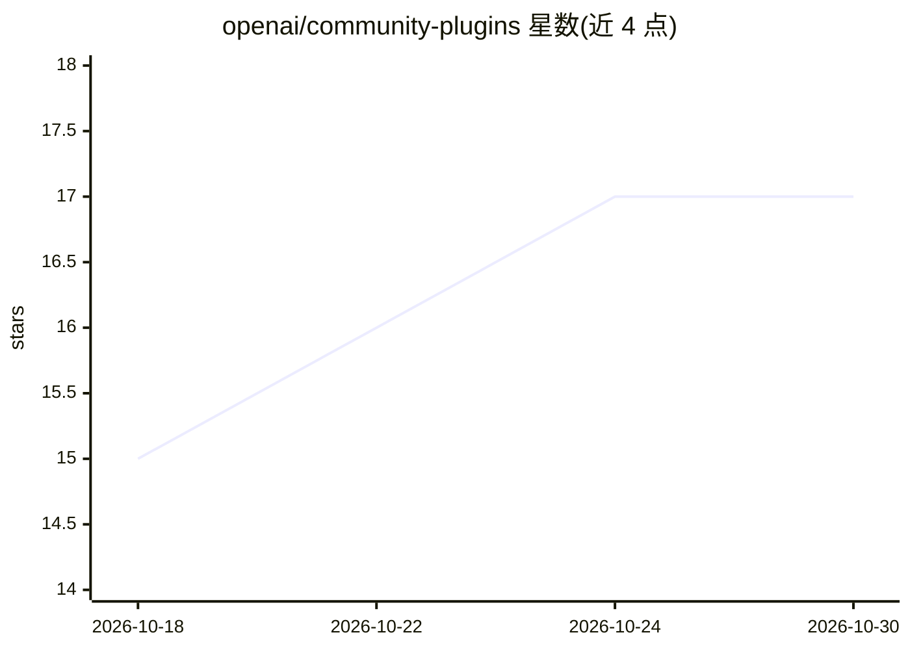

# openai/community-plugins

⭐ 17 · JavaScript · Apache-2.0 · 推送 2026-10-27 · [GitHub](https://github.com/openai/community-plugins) · 组织维护

**面向 Codex 的社区插件市场仓库，供检视后安装**

由 CDE 团队维护的 Git 托管 Codex 插件市场：收录 4 个插件（Grafana 观测、ReviewOps 审计基准、React Native 转 SwiftUI、Autodesk Fusion 互操作），每个插件带 manifest、安装指南、测试与许可声明。开发者可在 Codex 中以仓库 slug 或 CLI 命令添加市场，支持稀疏路径按需拉取单个插件。插件运行需 Codex 与 Node.js 22.19+，Fusion 开发测试套件另需 Python 3.12+。仓库为 Apache-2.0，插件可自带许可。

## 筛选速览

| 维度 | 判定 | 备注 |
|---|---|---|
| AI 角色 | `ai-ecosystem` | LLM/agent 周边工具 |
| 许可风险 | `permissive` | Apache-2.0 |
| 部署形态 | `None` |  |
| 模型依赖 | — | README 未给出锁定关系 |
| 硬件要求 | — | 无带数字的原话,不猜 |
| 安装摩擦 | `low` | 无编译、无系统依赖或容器化 |
| 成熟度 | — | 结构信号不足 |

## 能力要点

- 4 个插件：Grafana 观测、ReviewOps 审计、RN→SwiftUI 迁移、Autodesk Fusion 互操作
- Git-backed 市场，支持稀疏路径按需拉取与 CLI 管理（add/upgrade）
- 每个插件含 manifest、测试、许可与无凭据冒烟测试
- 权限边界声明（Read/Write 范围、ON_USE 认证）与离线合成 fixture

## 适用场景

- 为 Codex agent 添加基础设施观测、审计等技能
- 迁移 React Native 功能到 SwiftUI 并做对等性检查
- 企业团队在安装前审查插件来源与权限边界

## 场景标签

 · 领域:AI 开发工具/插件生态

## 证据(README 行号)

> L3: A public, Git-backed marketplace of Codex plugins that developers, prospects,
> L19: In Codex, choose **Add plugin marketplace** and use a repository slug or clone
> L70: codex plugin marketplace add tonyloehr/community-plugins \

## 星数曲线

2026-10-18 15 → 2026-10-30 17（+2）

---
*卡片 v1 · prompt 1.4 · 生成 2026-10-29 · 置信度 high · 依据 README sha `529131dbc2bf` · [字段定义](../../DATASET.md)*
