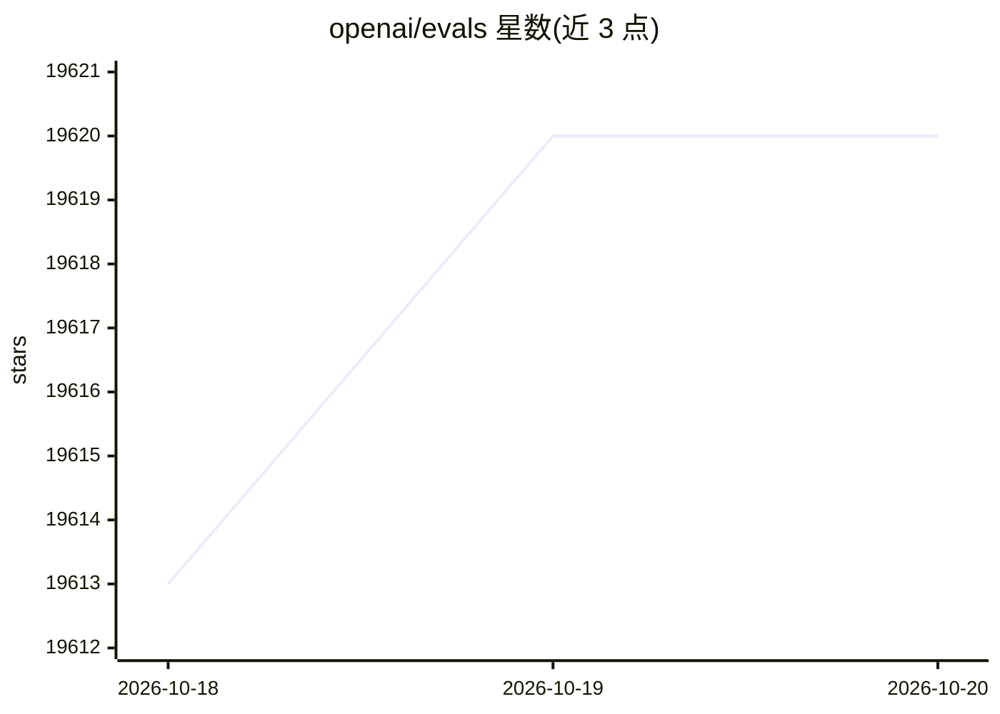

# openai/evals

⭐ 19,620 · Python · NOASSERTION · 推送 2026-04-14 · [GitHub](https://github.com/openai/evals) · 组织维护

**给 LLM 开发者提供评测框架与公开基准注册表**

OpenAI 提供的 LLM 评测框架与开源评测注册表：可运行注册表中的评测测试 OpenAI 模型的各维度表现，也可为自有用例编写自定义评测，并支持用私有数据构建不公开的评测。运行需配置 OPENAI_API_KEY 环境变量（README 提示注意 API 成本），要求 Python 3.9 以上；评测数据经 Git-LFS 存储可按需拉取，评测结果可记录到 Snowflake 数据库。评测模板以 YAML 加 JSON 数据方式定义，无需编写评测代码；目前不接受含自定义代码的评测贡献。

## 筛选速览

| 维度 | 判定 | 备注 |
|---|---|---|
| AI 角色 | `ai-ecosystem` | LLM/agent 周边工具 |
| 许可风险 | `none` | NOASSERTION |
| 部署形态 | `library` | 以包/库形式分发 |
| 模型依赖 | — | README 未给出锁定关系 |
| 硬件要求 | — | 无带数字的原话,不猜 |
| 安装摩擦 | `low` | 无编译、无系统依赖或容器化 |
| 成熟度 | — | 结构信号不足 |

## 动量与使用信号

- 维护:`declining` — 距上次 push 186.7 天,年发版 0,435 位贡献者
- 涨星:近 1 天 **+3**(自 20261016 起算)
- 安装:pypi 包 `evals` 月下载 457
- 平台:— · 协议:OPENAI-API

## 能力要点

- 开源评测注册表，经 Git-LFS 拉取，可按单个评测选择性获取数据
- 支持模型分级（model-graded）评测的 YAML 模板，无需编写评测代码
- 提供 Completion Function Protocol 支持提示链与工具调用 agent 类用例
- 评测结果可记录至 Snowflake 数据库

## 适用场景

- 对比不同模型版本对自身用例的影响
- 用私有工作流数据构建不公开的评测集
- 按现有模板快速提交评测供 OpenAI 参考

## 场景标签

`模型评测` · 领域:评测与运维

## 证据(README 行号)

> L5: Evals provide a framework for evaluating large language models (LLMs) or systems built using LLMs. We offer an exist
> L13: To run evals, you will need to set up and specify your OpenAI API key. After you obtain an API key, specify it usin
> L15: **Minimum Required Version: Python 3.9**

## 星数曲线

2026-10-18 19,613 → 2026-10-20 19,620（+7）

---
*卡片 v1 · prompt 1.4 · 生成 2026-10-18 · 置信度 high · 依据 README sha `b5ded0bd1b83` · [字段定义](../../DATASET.md)*
