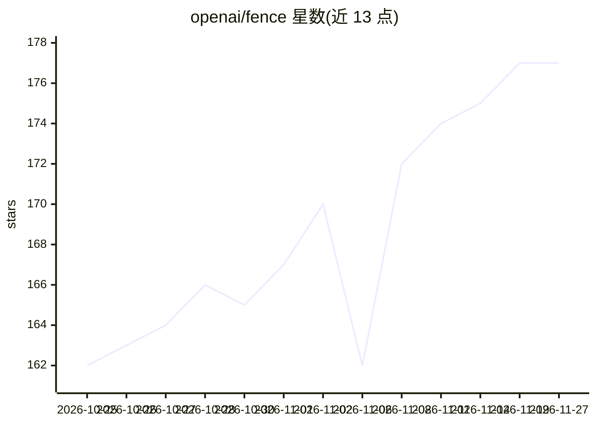

# openai/fence

⭐ 177 · Rust · MIT · 推送 2026-11-26 · [GitHub](https://github.com/openai/fence) · 组织维护

**给 GitHub Actions 作业加出站过滤与运行器锁定的安全 Action**

一个 GitHub Action，用于 CI 作业的出站流量过滤与 GitHub 托管 Linux 运行器加固。在作业第一步运行：默认阻断未允许的出站连接、关闭免密 sudo、禁用 Docker，并在作业摘要与日志中输出网络活动报告。支持 allowlist 精确到主机名（含 IPv6、端口、CIDR、通配符，上限 64 条）、audit 模式先行观察、GitHub Artifacts/Pages 存储端点放行开关。仅支持 ubuntu-24.04/26.04/latest x64 托管运行器；文档声明其不是完整沙箱。项目仍处于早期活跃开发阶段。

## 筛选速览

| 维度 | 判定 | 备注 |
|---|---|---|
| AI 角色 | `ai-enhanced` | 去掉 AI 部分产品仍成立 |
| 许可风险 | `permissive` | MIT |
| 部署形态 | `None` |  |
| 模型依赖 | — | README 未给出锁定关系 |
| 硬件要求 | — | 无带数字的原话,不猜 |
| 安装摩擦 | `low` | 无编译、无系统依赖或容器化 |
| 成熟度 | — | 结构信号不足 |

## 能力要点

- 默认阻断出站连接、关闭免密 sudo 与 Docker 访问
- allowlist 支持 IPv6/端口/TCP/UDP/CIDR/通配符，上限 64 条
- audit 模式先报告将拦截的内容再切换 block 模式
- 作业结束后输出网络活动 JSON 报告，可经 GitHub API 获取

## 适用场景

- 给 CI 工作流限制出站网络，防止依赖包外传数据
- 先用 audit 模式摸清工作流所需访问的域名再收紧策略
- 构建需要上传 Artifact/Pages 但仍要控制出口的流水线

## 场景标签

 · 领域:开发工具/CI-CD 安全

## 证据(README 行号)

> L12: A GitHub Action for egress filtering and runner lockdown.
> L27: Copy the full commit SHA and version comment from the latest verified release. Fence supports GitHub-hosted x64 run
> L136: Fence makes it harder for later workflow steps to send data to unexpected destinations or undo the runner's networ

## 星数曲线

2026-10-25 162 → 2026-11-27 177（+15）

---
*卡片 v1 · prompt 1.4 · 生成 2026-11-27 · 置信度 high · 依据 README sha `e4a4ecfae017` · [字段定义](../../DATASET.md)*
