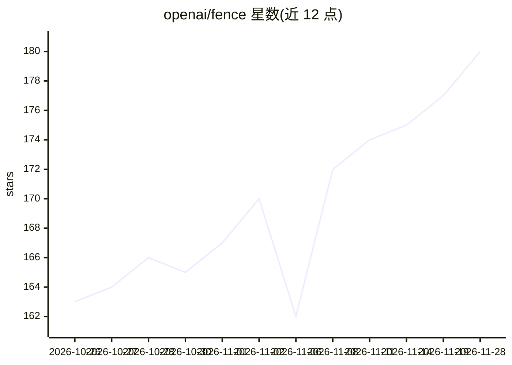

# openai/fence

⭐ 180 · Rust · MIT · 推送 2026-11-27 · [GitHub](https://github.com/openai/fence) · 组织维护

**GitHub Action：CI 出口流量过滤与 runner 锁定**

以 GitHub Action 形式提供的 egress 过滤与 runner 加固工具，用在 GitHub 托管的 Linux x64 作业中。默认阻止未列入白名单的出站连接、关闭免密 sudo 与 Docker 访问，并在作业总结与日志中报告网络活动；支持按主机名、IP、CIDR、端口与通配符配置 allowlist（上限 64 条），提供 audit 模式先观察再生成白名单。仅支持 ubuntu-24.04/26.04/latest 托管 runner，非完整沙箱。

## 筛选速览

| 维度 | 判定 | 备注 |
|---|---|---|
| AI 角色 | `ai-enhanced` | 去掉 AI 部分产品仍成立 |
| 许可风险 | `permissive` | MIT |
| 部署形态 | `None` |  |
| 模型依赖 | — | README 未给出锁定关系 |
| 硬件要求 | — | 无带数字的原话,不猜 |
| 安装摩擦 | `low` | 无编译、无系统依赖或容器化 |
| 成熟度 | — | 结构信号不足 |

## 能力要点

- 默认阻止出站连接并关闭免密 sudo 与 Docker 访问
- audit 模式观察将被阻止的流量并建议 allowlist 条目
- 支持 IPv6、自定义端口、TCP/UDP、CIDR 与主机名通配符
- 作业结束后输出网络活动报告（含 FENCE_REPORT_JSON）

## 适用场景

- 防止 CI 工作流中后续步骤向意外目的地发送数据
- 先跑 audit 模式摸清工作流所需的网络目的地再切阻断
- 限制构建作业只能访问白名单内的主机名

## 场景标签

 · 领域:开发工具/CI 安全

## 证据(README 行号)

> L12: A GitHub Action for egress filtering and runner lockdown.
> L31: - Blocks outbound connections unless the hosted runner needs them or you allow them.

## 星数曲线

2026-10-26 163 → 2026-11-28 180（+17）

---
*卡片 v1 · prompt 1.4 · 生成 2026-11-28 · 置信度 mid · 依据 README sha `1c8badc076e6` · [字段定义](../../DATASET.md)*
