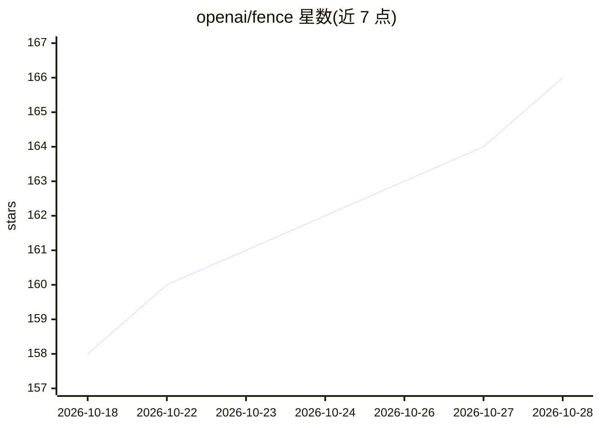

# openai/fence

⭐ 166 · Rust · MIT · 推送 2026-10-27 · [GitHub](https://github.com/openai/fence) · 组织维护

**GitHub Actions 托管运行器的出站过滤与锁定 Action**

OpenAI 维护的 GitHub Action，面向使用 GitHub 托管 Linux 运行器（ubuntu-24.04 / ubuntu-latest x64）的 CI 团队：在作业首个步骤运行，默认阻断未列入允许清单的出站连接、关闭免密 sudo 与 Docker 访问，并校验防火墙实际生效。支持审计模式（只报告不阻断）、IPv6/CIDR/通配符主机名等允许清单语法（上限 64 条），作业结束时输出网络活动报告（含 FENCE_REPORT_JSON）。README 声明项目处于早期活跃开发阶段，且其自身声明'并非完整沙箱'。本体不含 AI 能力。

## 筛选速览

| 维度 | 判定 | 备注 |
|---|---|---|
| AI 角色 | `ai-enhanced` | 去掉 AI 部分产品仍成立 |
| 许可风险 | `permissive` | MIT |
| 部署形态 | `None` |  |
| 模型依赖 | — | README 未给出锁定关系 |
| 硬件要求 | — | 无带数字的原话,不猜 |
| 安装摩擦 | `low` | 无编译、无系统依赖或容器化 |
| 成熟度 | — | 结构信号不足 |

## 能力要点

- 默认阻断非允许出站连接并关闭 sudo/Docker 访问
- 审计模式预演将被阻断的流量并建议允许清单条目
- 作业结束前持续校验防护仍生效，异常即令作业失败
- 输出网络活动表与 FENCE_REPORT_JSON 报告

## 适用场景

- CI 作业中限制构建步骤只能访问指定网络目的地
- 审计工作流实际需要哪些出站连接
- 供应链安全加固，防止后续步骤外发数据或提权

## 场景标签

`网络安全` · 领域:学习与行业

## 证据(README 行号)

> L12: A GitHub Action for egress filtering and runner lockdown.

## 星数曲线

2026-10-18 158 → 2026-10-28 166（+8）

---
*卡片 v1 · prompt 1.4 · 生成 2026-10-22 · 置信度 low · 依据 README sha `31e63fd81533` · [字段定义](../../DATASET.md)*
