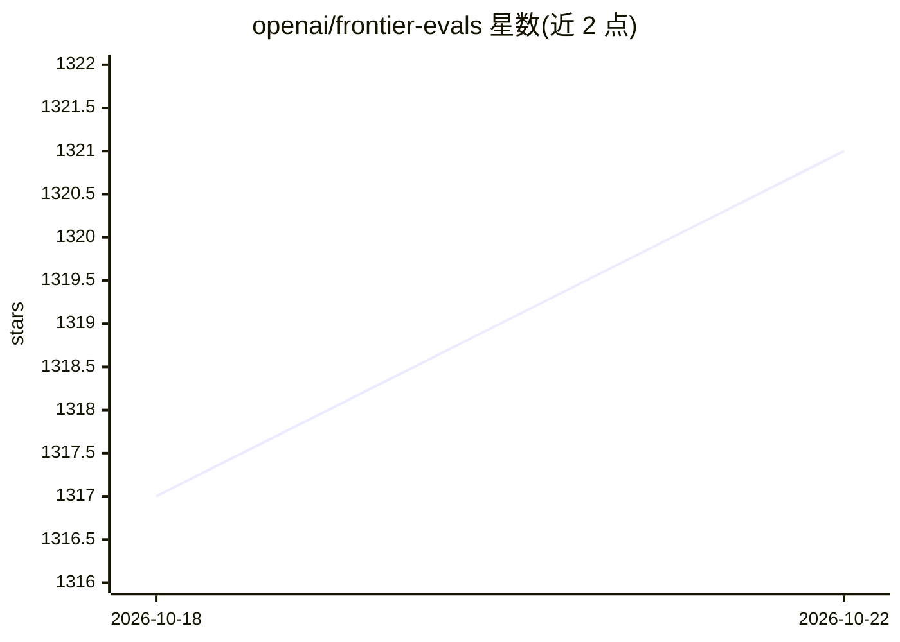

# openai/frontier-evals

⭐ 1,321 · Python · MIT · 推送 2026-10-12 · [GitHub](https://github.com/openai/frontier-evals) · 组织维护

**OpenAI 前沿模型能力评测代码集（PaperBench/SWE-Lancer 等）**

OpenAI 维护的前沿模型评测代码仓库，包含多个评测套件：PaperBench（端到端复现先进 AI 论文）、SWE-Lancer（带端到端测试的真实自由职业软件工程任务）、EVMbench（智能合约安全任务）。各评测目录为隔离项目，含独立 README、pyproject.toml 与 uv.lock；用 uv 管理环境，uv sync 安装依赖后按目录内说明复现运行、配置模型并解读结果。面向评测研究人员与工程团队。

## 筛选速览

| 维度 | 判定 | 备注 |
|---|---|---|
| AI 角色 | `ai-ecosystem` | LLM/agent 周边工具 |
| 许可风险 | `permissive` | MIT |
| 部署形态 | `library` | 以包/库形式分发 |
| 模型依赖 | — | README 未给出锁定关系 |
| 硬件要求 | — | 无带数字的原话,不猜 |
| 安装摩擦 | `low` | 无编译、无系统依赖或容器化 |
| 成熟度 | — | 结构信号不足 |

## 能力要点

- PaperBench：端到端复现先进 AI 论文
- SWE-Lancer：真实自由职业软件工程任务与端到端测试
- EVMbench：智能合约安全任务
- 各评测为隔离项目，uv 管理依赖与复现

## 适用场景

- 复现前沿模型能力评测运行结果
- 在自选模型上跑论文复现或软件工程任务评测
- 研究智能合约安全能力评测任务设计

## 场景标签

 · 领域:AI 评测/研究

## 证据(README 行号)

> L3: Code for evals measuring frontier model capabilities.
> L17: Each eval directory documents how to reproduce runs, configure models, and interpret results. Start with the suite 

## 星数曲线

2026-10-18 1,317 → 2026-10-22 1,321（+4）

---
*卡片 v1 · prompt 1.4 · 生成 2026-10-21 · 置信度 mid · 依据 README sha `f1d9e2dba705` · [字段定义](../../DATASET.md)*
