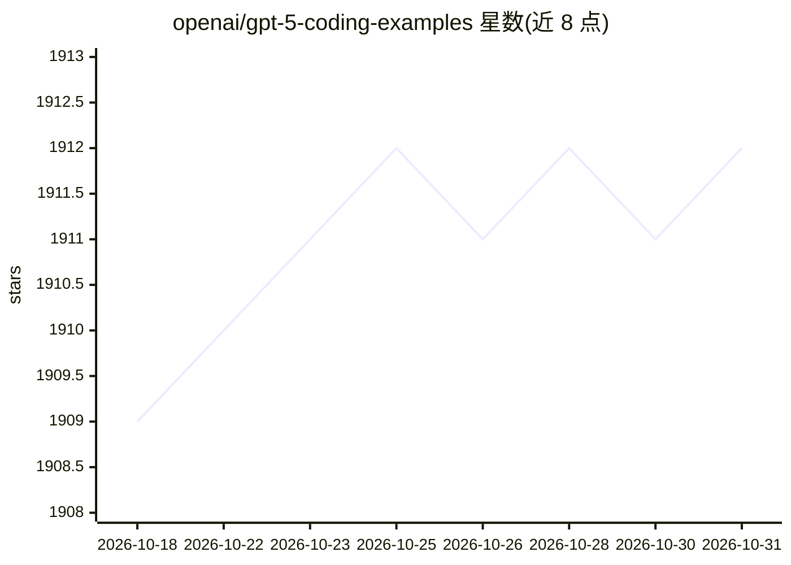

# openai/gpt-5-coding-examples

⭐ 1,912 · HTML · MIT · 推送 2025-12-11 · [GitHub](https://github.com/openai/gpt-5-coding-examples) · [官网](https://gpt5-coding-examples.vercel.app/) · 组织维护

**GPT-5 单提示生成的编码示例合集，供参考与二次创作**

OpenAI 维护的示例库：收录全部由 GPT-5/GPT-5.2 单次提示生成、未手写代码的演示应用，涵盖网站、前端应用、游戏与交互 UI。仓库提供一个可本地克隆运行的前端站点（npm install / npm run dev，localhost:3000），每个示例附原始零样本提示，可查看并改写；另有托管在线版本。README 同时给出用 Codex CLI 或 ChatGPT 复现类似提示的操作指引。不接受贡献，仅供参考与启发。

## 筛选速览

| 维度 | 判定 | 备注 |
|---|---|---|
| AI 角色 | `ai-knowledge` | 知识聚合/清单类 |
| 许可风险 | `permissive` | MIT |
| 部署形态 | `library` | 以包/库形式分发 |
| 模型依赖 | — | README 未给出锁定关系 |
| 硬件要求 | — | 无带数字的原话,不猜 |
| 安装摩擦 | `low` | 无编译、无系统依赖或容器化 |
| 成熟度 | — | 结构信号不足 |

## 能力要点

- 示例代码全部由 GPT-5/GPT-5.2 单次提示生成，无手写代码
- 每个示例附原始零样本提示，可查看与 remix
- 提供可本地运行的前端站点与在线托管版本
- 附 Codex CLI 与 ChatGPT 两条复现路径指引

## 适用场景

- 浏览 GPT-5 单提示生成的应用示例寻找灵感
- 复制示例提示词到 Codex CLI 或 ChatGPT 复现和改造
- 研究零样本提示生成的代码效果

## 场景标签

`精选清单` `代码生成` · 领域:编码与开发

## 证据(README 行号)

> L3: This repository contains a curated collection of demo applications **generated entirely in a single GPT-5 or GPT-5.2
> L5: These demos were selected to showcase the model’s strengths in coding — especially quickly scaffolding websites, fro

## 星数曲线

2026-10-18 1,909 → 2026-10-31 1,912（+3）

---
*卡片 v1 · prompt 1.4 · 生成 2026-10-21 · 置信度 high · 依据 README sha `aa02a5b18258` · [字段定义](../../DATASET.md)*
