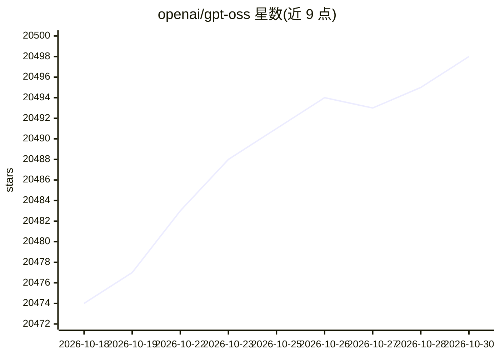

# openai/gpt-oss

⭐ 20,498 · Python · Apache-2.0 · 推送 2026-10-29 · [GitHub](https://github.com/openai/gpt-oss) · [官网](https://openai.com/open-models) · 组织维护

**OpenAI 开放权重的两个开源语言模型（120B/20B）**

本仓库提供 gpt-oss-120b 与 gpt-oss-20b 两个开放权重模型的参考实现与工具链：PyTorch、Triton、Metal 三种推理实现，浏览器与 Python 两个内置工具，终端聊天客户端与 Responses API 示例服务器。模型采用 harmony 响应格式训练，需以该格式调用；权重经 MXFP4 量化，120b 可在单张 80GB GPU 上运行，20b 可在 16GB 内存内运行。提供 Transformers、vLLM、Ollama、LM Studio 等多种推理途径。

## 筛选速览

| 维度 | 判定 | 备注 |
|---|---|---|
| AI 角色 | `ai-native` | 本体是模型或模型工具 |
| 许可风险 | `permissive` | Apache-2.0 |
| 部署形态 | `library` | 以包/库形式分发 |
| 模型依赖 | local-ok | 支持本地模型 |
| 硬件要求 | — | 无带数字的原话,不猜 |
| 安装摩擦 | `medium` | 含编译或系统依赖之一 |
| 成熟度 | — | 结构信号不足 |

## 动量与使用信号

- 维护:`active` — 距上次 push 5.5 天,年发版 1,64 位贡献者
- 涨星:近 1 天 **+3**(自 20261016 起算)
- 安装:pypi 包 `gpt-oss` 月下载 36,706
- 平台:— · 协议:OPENAI-API / OLLAMA

## 能力要点

- 两个开放权重模型：117B/5.1B 激活与 21B/3.6B 激活
- MXFP4 量化 MoE 权重，120b 适配单张 80GB GPU，20b 适配 16GB 内存
- 原生函数调用、网页浏览、Python 代码执行与 Structured Outputs 能力
- Apache 2.0 许可，支持参数微调与三档推理努力配置

## 适用场景

- 在自有 GPU 或消费级硬件上本地部署推理服务
- 为 Agent 应用接入函数调用与浏览/代码执行工具
- 基于开放权重做微调定制
- 研究模型架构与推理过程的参考实现

## 场景标签

`推理引擎` · 领域:训练与推理

## 证据(README 行号)

> L10: Welcome to the gpt-oss series, OpenAI's open-weight models designed for powerful reasoning, agentic tasks, and vers
> L28: - **MXFP4 quantization:** The models were post-trained with MXFP4 quantization of the MoE weights, making `gpt-oss-
> L104: This repository provides a collection of reference implementations:

## 星数曲线

2026-10-18 20,474 → 2026-10-30 20,498（+24）

---
*卡片 v1 · prompt 1.4 · 生成 2026-10-18 · 置信度 high · 依据 README sha `d7597260c8a6` · [字段定义](../../DATASET.md)*
