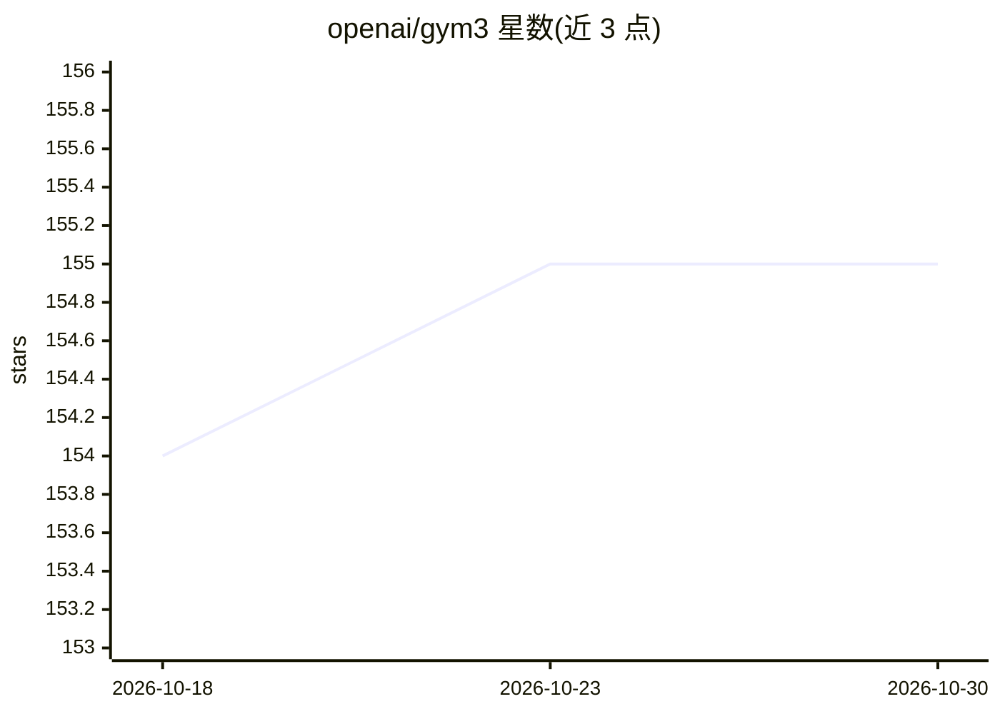

# openai/gym3

⭐ 155 · Python · MIT · 推送 2026-03-26 · [GitHub](https://github.com/openai/gym3) · 组织维护

**强化学习环境向量化接口库（gym 接口的改进版）**

提供统一的强化学习环境接口，核心是向量化：将多个 gym.Env 合并为单一环境，episode 结束时自动 reset。仅含接口与工具，附带少量测试环境（Gridworld、Computer Tennis、libenv C API 示例），并支持通过 vectorize_gym 包装既有 gym 环境。观察与动作支持数组或嵌套字典树结构，附带 types_np 工具。支持 Windows/macOS/Linux，Python>=3.6。README 声明处于维护状态（仅修复与小幅更新），且主要面向 OpenAI 内部及 OpenAI 环境使用，外部用户建议使用 gym。

## 筛选速览

| 维度 | 判定 | 备注 |
|---|---|---|
| AI 角色 | `ai-ecosystem` | LLM/agent 周边工具 |
| 许可风险 | `permissive` | MIT |
| 部署形态 | `library` | 以包/库形式分发 |
| 模型依赖 | — | README 未给出锁定关系 |
| 硬件要求 | — | 无带数字的原话,不猜 |
| 安装摩擦 | `low` | 无编译、无系统依赖或容器化 |
| 成熟度 | — | 结构信号不足 |

## 能力要点

- 多环境合并为单一环境，episode 完成自动 reset
- 兼容既有 gym 环境（vectorize_gym）
- 支持数组与嵌套字典树结构的观察/动作及 multimap、types_np 工具
- 跨平台支持（Windows/macOS/Linux），Python>=3.6

## 适用场景

- 以向量化方式并行运行多个强化学习环境
- 将现有 gym 环境接入 gym3 接口
- 配合 Procgen 等环境做高效采样训练

## 场景标签

`强化学习` · 领域:训练与推理

## 证据(README 行号)

> L5: `gym3` provides a unified interface for reinforcement learning environments that improves upon the `gym` interface a
> L7: `gym3` is used internally inside OpenAI and is released here primarily for use by OpenAI environments. External user

## 星数曲线

2026-10-18 154 → 2026-10-30 155（+1）

---
*卡片 v1 · prompt 1.4 · 生成 2026-10-22 · 置信度 high · 依据 README sha `5aa2bd546627` · [字段定义](../../DATASET.md)*
