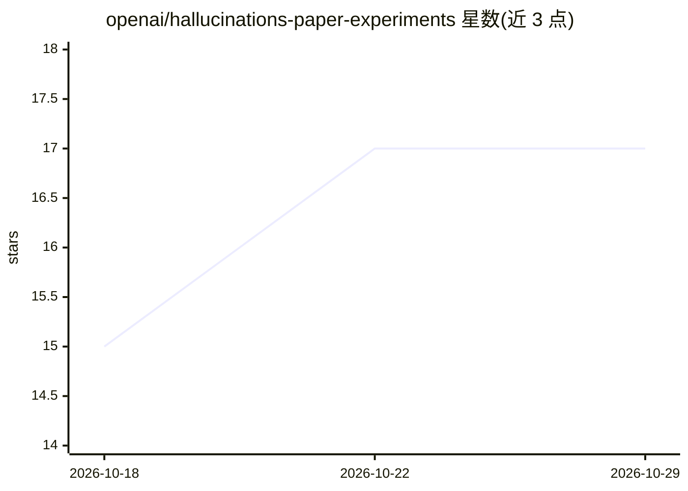

# openai/hallucinations-paper-experiments

⭐ 17 · Jupyter Notebook · MIT · 推送 2026-05-15 · [GitHub](https://github.com/openai/hallucinations-paper-experiments) · 组织维护

**复现 Nature 论文的 LLM 幻觉评测实验 notebook**

论文《Evaluating large language models for accuracy incentivises hallucinations》（Kalai 等，Nature 2026）的配套实验代码：单个 Jupyter notebook 下载 SimpleQA 测试集（4,326 题），通过 OpenRouter API 查询四个前沿模型（gemini-3-pro-preview、gpt-5.2、grok-4、claude-opus-4.5），在不同惩罚系数与弃答指令下用 GPT-4.1 打分，生成论文样式图表。含磁盘缓存保证可复现重跑。需要 OPENROUTER_API_KEY，全量四模型实验成本约 $2,778，可用 NUM_SAMPLES 减小规模。面向科研复现者。

## 筛选速览

| 维度 | 判定 | 备注 |
|---|---|---|
| AI 角色 | `ai-ecosystem` | LLM/agent 周边工具 |
| 许可风险 | `permissive` | MIT |
| 部署形态 | `library` | 以包/库形式分发 |
| 模型依赖 | locked-api |  |
| 硬件要求 | — | 无带数字的原话,不猜 |
| 安装摩擦 | `low` | 无编译、无系统依赖或容器化 |
| 成熟度 | — | 结构信号不足 |

## 能力要点

- SimpleQA 全量 4,326 题上评测四个前沿模型
- 惩罚系数 L∈{0,1,3,9}、Open/Closed Rubric、一致性缓解多维度组合
- diskcache 磁盘缓存模型调用，保证可复现重跑
- 可设置 NUM_SAMPLES=10 做低成本冒烟测试

## 适用场景

- 复现或验证论文中的幻觉评测结果
- 调整惩罚系数与弃答指令后重跑分析
- 在 SimpleQA 上对其他模型做同类幻觉评测

## 场景标签

`模型评测` `科研工具` · 领域:评测与运维

## 证据(README 行号)

> L15: * **`experiment.ipynb`**: downloads the SimpleQA test set, queries four frontier LMs under different abstention ins
> L28: * **Grading**: uses `openai/gpt-4.1` with the SimpleQA grader template (copied into the notebook).

## 星数曲线

2026-10-18 15 → 2026-10-29 17（+2）

---
*卡片 v1 · prompt 1.4 · 生成 2026-10-29 · 置信度 high · 依据 README sha `79719f820c31` · [字段定义](../../DATASET.md)*
