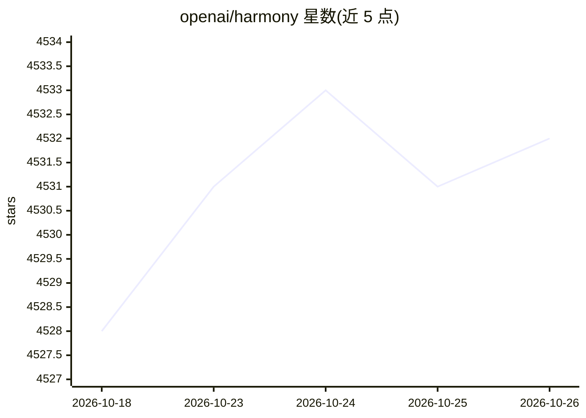

# openai/harmony

⭐ 4,532 · Rust · Apache-2.0 · 推送 2026-04-08 · [GitHub](https://github.com/openai/harmony) · 组织维护

**gpt-oss 的 harmony 响应格式渲染与解析库（Rust/Python）**

OpenAI 为其开放权重模型系列 gpt-oss 所用 harmony 响应格式提供的官方渲染与解析库。harmony 格式定义对话结构、推理输出与函数调用，支持多通道输出（思维链、工具调用前导、常规回复）、多工具命名空间与结构化输出。核心用 Rust 实现，提供 Python 包（pip 安装、含类型桩）与 Rust crate（Cargo 依赖 git 源）。适用于自建推理方案的开发者；经 API 或 HuggingFace/Ollama/vLLM 使用 gpt-oss 的用户无需直接处理此格式。

## 筛选速览

| 维度 | 判定 | 备注 |
|---|---|---|
| AI 角色 | `ai-ecosystem` | LLM/agent 周边工具 |
| 许可风险 | `permissive` | Apache-2.0 |
| 部署形态 | `library` | 以包/库形式分发 |
| 模型依赖 | — | README 未给出锁定关系 |
| 硬件要求 | — | 无带数字的原话,不猜 |
| 安装摩擦 | `low` | 无编译、无系统依赖或容器化 |
| 成熟度 | — | 结构信号不足 |

## 能力要点

- 渲染与解析共享实现，token 序列无损
- 核心逻辑用 Rust 实现，Python 测试与 Rust 测试套件 100% 对齐
- 同时提供 Python 包（pip）与 Rust crate（Cargo.toml git 依赖）
- 格式模仿 OpenAI Responses API

## 适用场景

- 自建 gpt-oss 推理方案时处理 prompt 与响应格式
- 解析 gpt-oss 的多通道输出（思维链、工具调用）
- 在 Rust 或 Python 工程中集成 harmony 格式的编解码

## 场景标签

 · 领域:LLM 基础设施

## 证据(README 行号)

> L3:  OpenAI's response format for its open-weight model series gpt-oss
> L7: The [gpt-oss models][gpt-oss] were trained on the [harmony response format][harmony-format] for defining conversatio

## 星数曲线

2026-10-18 4,528 → 2026-10-26 4,532（+4）

---
*卡片 v1 · prompt 1.4 · 生成 2026-10-20 · 置信度 high · 依据 README sha `19d3e53c9b74` · [字段定义](../../DATASET.md)*
