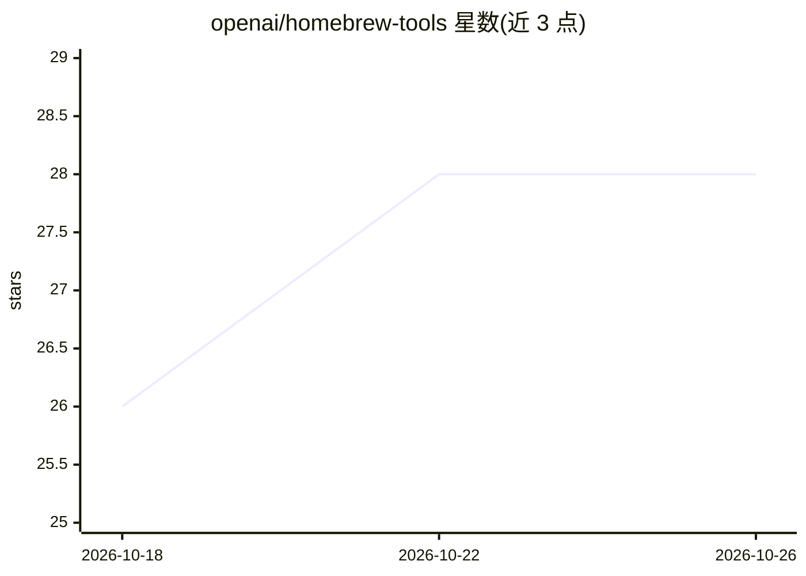

# openai/homebrew-tools

⭐ 28 · Ruby · Apache-2.0 · 推送 2026-10-25 · [GitHub](https://github.com/openai/homebrew-tools) · 组织维护

**OpenAI 官方 Homebrew tap，分发 OpenAI CLI 及 Tart 相关命令行工具**

OpenAI 维护的 Homebrew tap 仓库，发布 openai cask（OpenAI CLI 的 Homebrew 安装通道，cask 定义由 CLI 发布工作流自动生成），并发布 Tart 相关 formulas（tart、softnet、orchard、tart-guest-agent）。面向使用 macOS Homebrew 的开发者，通过 brew install openai/tools/<name> 安装。README 未描述 CLI 本身功能细节，属分发渠道仓库而非产品本体。

## 筛选速览

| 维度 | 判定 | 备注 |
|---|---|---|
| AI 角色 | `ai-ecosystem` | LLM/agent 周边工具 |
| 许可风险 | `permissive` | Apache-2.0 |
| 部署形态 | `None` |  |
| 模型依赖 | — | README 未给出锁定关系 |
| 硬件要求 | — | 无带数字的原话,不猜 |
| 安装摩擦 | `low` | 无编译、无系统依赖或容器化 |
| 成熟度 | — | 结构信号不足 |

## 能力要点

- 发布 openai cask 用于安装 OpenAI CLI
- cask 定义由 OpenAI CLI 发布工作流生成
- 另发布 tart/softnet/orchard/tart-guest-agent 四个 formulas

## 适用场景

- 用 Homebrew 安装 OpenAI CLI
- 用 Homebrew 安装 Tart 相关的虚拟化/编排工具

## 场景标签

 · 领域:软件分发/开发者工具

## 证据(README 行号)

> L3: Homebrew tap for OpenAI command-line tools.
> L7: This tap publishes the `openai` cask for the OpenAI CLI once public release artifacts are available.

## 星数曲线

2026-10-18 26 → 2026-10-26 28（+2）

---
*卡片 v1 · prompt 1.4 · 生成 2026-10-26 · 置信度 high · 依据 README sha `2c53ceda4414` · [字段定义](../../DATASET.md)*
