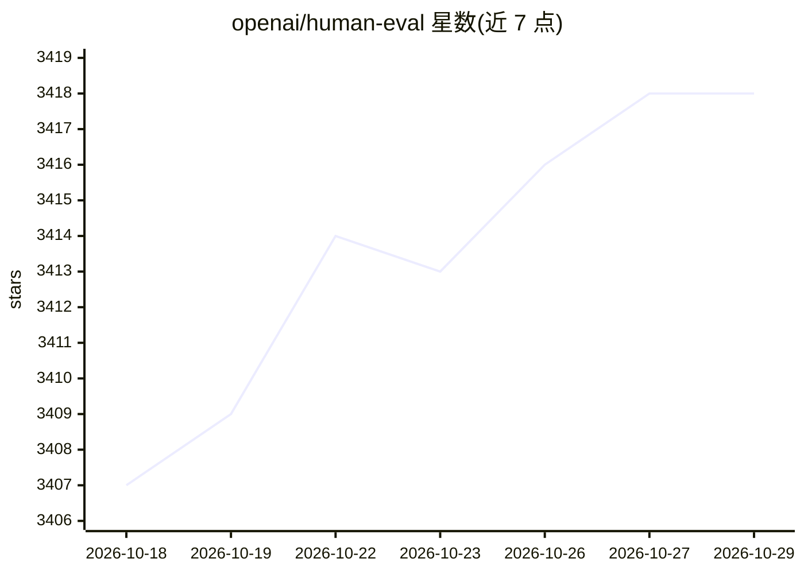

# openai/human-eval

⭐ 3,418 · Python · MIT · 推送 2026-10-16 · [GitHub](https://github.com/openai/human-eval) · 组织维护

**代码生成模型的函数正确性评测基准与评测工具**

论文《Evaluating Large Language Models Trained on Code》的配套代码：提供 HumanEval 手写代码问题数据集与评测脚手架，用户将模型补全结果按 jsonl 格式写入文件，运行 evaluate_functional_correctness 脚本执行生成的代码，输出 pass@k 指标及逐条 passed/timed out/failed 结果。仓库声明已弃用且不再维护，仅供历史参考；执行不可信的模型生成代码需用户自行在安全沙箱中运行，执行调用默认被注释掉需手动启用。

## 筛选速览

| 维度 | 判定 | 备注 |
|---|---|---|
| AI 角色 | `ai-ecosystem` | LLM/agent 周边工具 |
| 许可风险 | `permissive` | MIT |
| 部署形态 | `library` | 以包/库形式分发 |
| 模型依赖 | — | README 未给出锁定关系 |
| 硬件要求 | — | 无带数字的原话,不猜 |
| 安装摩擦 | `low` | 无编译、无系统依赖或容器化 |
| 成熟度 | — | 结构信号不足 |

## 能力要点

- 手写代码问题集 HumanEval 与配套评测脚手架
- evaluate_functional_correctness 命令输出 pass@k 与逐条通过/超时/失败结果
- 默认禁用执行调用，需阅读安全声明后手动启用

## 适用场景

- 评测代码生成模型的函数正确性（pass@k）
- 复现 Codex 论文中的评测结果
- 以统一基准比较不同模型的代码补全能力

## 场景标签

`模型评测` · 领域:评测与运维

## 证据(README 行号)

> L7: This is an evaluation harness for the HumanEval problem solving dataset
> L8: described in the paper "[Evaluating Large Language Models Trained on
> L9: Code](https://arxiv.org/abs/2107.03374)".

## 星数曲线

2026-10-18 3,407 → 2026-10-29 3,418（+11）

---
*卡片 v1 · prompt 1.4 · 生成 2026-10-20 · 置信度 mid · 依据 README sha `54a07967d6a4` · [字段定义](../../DATASET.md)*
