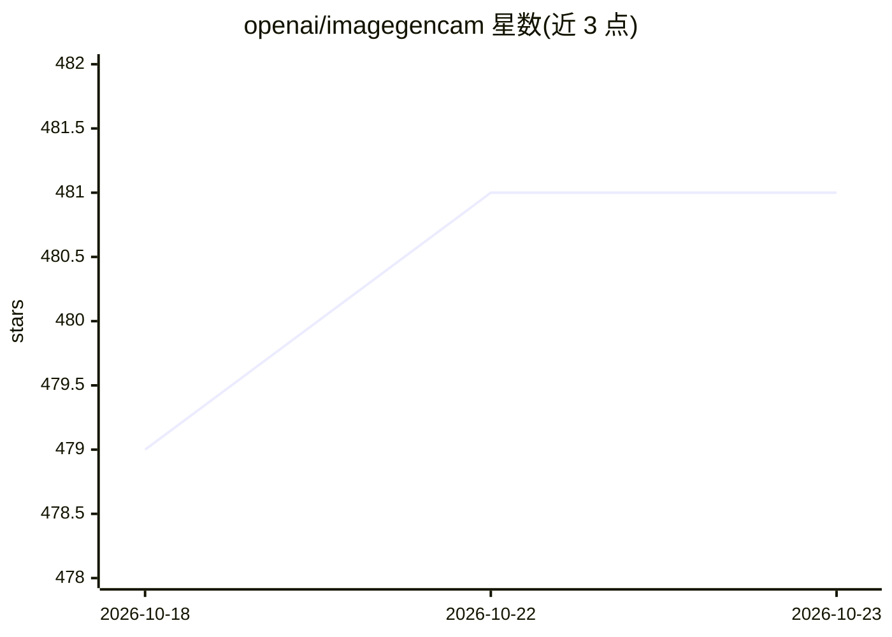

# openai/imagegencam

⭐ 481 · Python · Apache-2.0 · 推送 2026-06-08 · [GitHub](https://github.com/openai/imagegencam) · 组织维护

**用 Codex 协助自制的拍照+图像生成数码相机套件**

Raspberry Pi Zero 2 W 与 3D 打印外壳组装的 DIY 数码相机项目：拍摄照片后由 ChatGPT Images 2.0 生成变换图像，配手机 Web 应用下载照片、编辑提示词。构建流程通过在 Mac 上打开 Codex Desktop 输入仓库地址，由 Codex 逐步引导完成；需 OpenAI 账号与 Wi-Fi。面向创客、艺术家与工程师，定位为周末级项目，可用 Codex 修改软件适配其他硬件。Apache 2.0 许可。

## 筛选速览

| 维度 | 判定 | 备注 |
|---|---|---|
| AI 角色 | `ai-native` | 本体是模型或模型工具 |
| 许可风险 | `permissive` | Apache-2.0 |
| 部署形态 | `None` |  |
| 模型依赖 | — | README 未给出锁定关系 |
| 硬件要求 | — | 无带数字的原话,不猜 |
| 安装摩擦 | `low` | 无编译、无系统依赖或容器化 |
| 成熟度 | — | 结构信号不足 |

## 能力要点

- 拍摄照片后由 ChatGPT Images 2.0 生成图像变换
- 通过 Codex Desktop 对话逐步引导组装与构建
- 配套手机 Web 应用：下载照片、编辑提示词
- 提供 .step 文件可自定义 3D 打印外壳

## 适用场景

- 周末 DIY 一台可自定义提示词的图像生成相机
- 让 Codex 修改相机软件与 Magic Button 功能
- 创客学习 Raspberry Pi 与 3D 打印组合项目

## 场景标签

`图像生成` · 领域:内容生成

## 证据(README 行号)

> L11: Take photos, transform them with image generation, and keep tuning the
> L74: weird point-and-shoot. Pick a prompt, snap a photo, and ChatGPT Images 2.0 will

## 星数曲线

2026-10-18 479 → 2026-10-23 481（+2）

---
*卡片 v1 · prompt 1.4 · 生成 2026-10-21 · 置信度 high · 依据 README sha `09a30b7ee2cc` · [字段定义](../../DATASET.md)*
