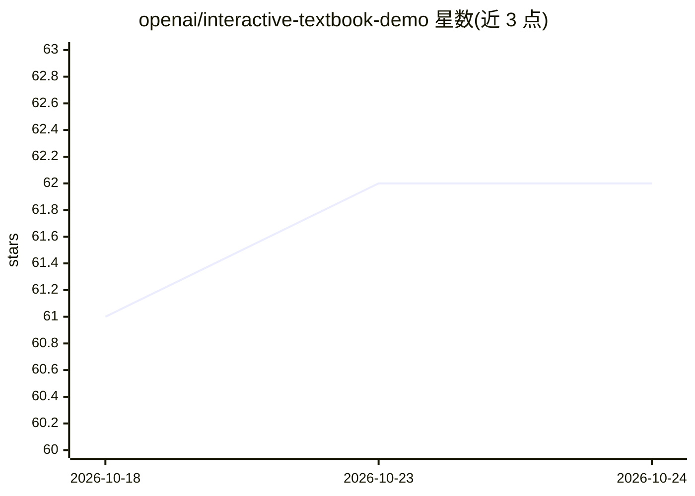

# openai/interactive-textbook-demo

⭐ — · [GitHub]() · 组织维护

**展示 OpenAI 技术构建无障碍交互式教科书的演示项目**

由 OpenAI 维护的交互式教科书演示代码库，展示如何用 OpenAI 的技术帮助有视觉障碍或语言与学习障碍的人群更便捷地获取教科书内容。开发者需在项目根目录创建 .env.local 并配置 OpenAI API key，通过 npm install 安装依赖后以 npm run dev 运行开发环境。仓库另包含基于 trufflehog 的 pre-commit 钩子，用于提交前扫描 API key 等敏感信息。README 未详述交互形式与具体功能模块。

## 筛选速览

| 维度 | 判定 | 备注 |
|---|---|---|
| AI 角色 | `ai-native` | 本体是模型或模型工具 |
| 许可风险 | `permissive` | — |
| 部署形态 | `library` | 以包/库形式分发 |
| 模型依赖 | — | README 未给出锁定关系 |
| 硬件要求 | — | 无带数字的原话,不猜 |
| 安装摩擦 | `low` | 无编译、无系统依赖或容器化 |
| 成熟度 | — | 结构信号不足 |

## 能力要点

- 面向视觉障碍与语言/学习障碍人群的无障碍教科书演示
- 使用 OpenAI API，需配置 API key 运行
- 内置 trufflehog pre-commit 钩子扫描泄露的密钥

## 适用场景

- 参考如何用 OpenAI 技术构建无障碍学习材料
- 作为交互式教科书应用的起步代码

## 场景标签

`教程课程` · 领域:学习与行业

## 证据(README 行号)

> L5: This repository contains the code for an interactive textbook demo that showcases how OpenAI's technologies can be u
> L9: Create `.env.local` file in the project root and copy the contents of `.env.example` into it. You can create an Open

## 星数曲线

2026-10-18 61 → 2026-10-24 62（+1）

---
*卡片 v1 · prompt 1.4 · 生成 2026-10-24 · 置信度 low · 依据 README sha `655a8f633ffc` · [字段定义](../../DATASET.md)*
