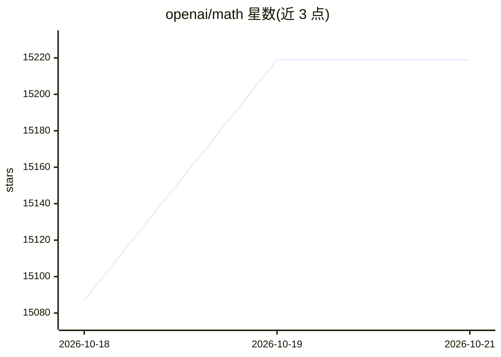

# openai/math

⭐ 15,219 · Lean · Apache-2.0 · 推送 2026-10-12 · [GitHub](https://github.com/openai/math) · 组织维护

**面向数学研究者的 OpenAI 模型生成数学论文集与证明工件**

该仓库收录由 OpenAI 内部模型产出的数学稿件及配套证明材料，共 719 篇手稿、组织为 372 个结果族，按数学学科分类。提供概览、手稿地图、preprints 目录（含 PDF、源文件与构建说明）、Lean 形式化目录与 Comparator 校验说明，约 42% 顶级结果已形式化；部分结果尚无 Lean 形式化且可能存在问题。每篇手稿目录内含 BibTeX 引用块，版本修订以新版本形式保留。

## 筛选速览

| 维度 | 判定 | 备注 |
|---|---|---|
| AI 角色 | `ai-native` | 本体是模型或模型工具 |
| 许可风险 | `permissive` | Apache-2.0 |
| 部署形态 | `None` |  |
| 模型依赖 | — | README 未给出锁定关系 |
| 硬件要求 | — | 无带数字的原话,不猜 |
| 安装摩擦 | `low` | 无编译、无系统依赖或容器化 |
| 成熟度 | — | 结构信号不足 |

## 动量与使用信号

- 维护:`active` — 距上次 push 5.5 天,年发版 0,3 位贡献者
- 涨星:近 1 天 **+102**(自 20261016 起算)

## 能力要点

- 719 篇手稿按 372 个结果族组织，按数学学科分类
- 约 42% 顶级结果附带 Lean 形式化证明
- 提供手稿推理摘要与 preprints 源文件及构建说明
- 版本历史保留，修订以新版本发布

## 适用场景

- 查阅 OpenAI 模型在开放数学问题上的产出结果
- 获取带 Lean 形式化的数学证明材料
- 按结果族引用具体手稿（BibTeX）

## 场景标签

`科研工具` · 领域:学习与行业

## 证据(README 行号)

> L3: This repository contains mathematical manuscripts and supporting proof artifacts produced by an internal OpenAI mode
> L14: The current catalogue contains 719 manuscripts organized into 372 families. A family groups related papers, which m
> L19: - The Lean library and formalization catalogue describe the available formal proofs, their associated papers, and v

## 星数曲线

2026-10-18 15,087 → 2026-10-21 15,219（+132）

---
*卡片 v1 · prompt 1.4 · 生成 2026-10-18 · 置信度 high · 依据 README sha `8cd3a12303d7` · [字段定义](../../DATASET.md)*
