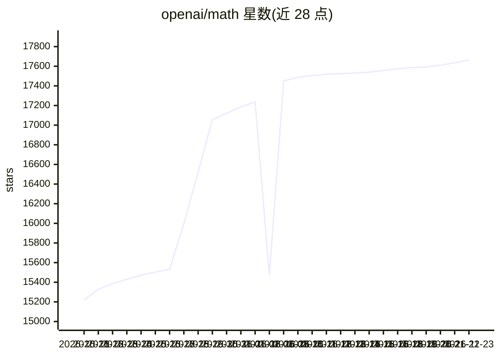

# openai/math

⭐ 17,664 · Lean · Apache-2.0 · 推送 2026-10-30 · [GitHub](https://github.com/openai/math) · 组织维护

**OpenAI 内部模型生成的数学论文与证明工件合集**

由 OpenAI 未发布的内部模型产出的数学手稿与证明材料的开放仓库，含 721 篇手稿、373 个按数学学科分类的族，部分结果附 Lean 形式化证明（约 42% 顶级结果已形式化），并提供模型推理摘要与各手稿的引用 BibTeX。README 明确说明结果处于不同验证阶段，部分未形式化结果可能存在问题；产出方式平均每个结果消耗三小时 ChatGPT Pro 级别的思考算力。

## 筛选速览

| 维度 | 判定 | 备注 |
|---|---|---|
| AI 角色 | `ai-knowledge` | 知识聚合/清单类 |
| 许可风险 | `permissive` | Apache-2.0 |
| 部署形态 | `None` |  |
| 模型依赖 | — | README 未给出锁定关系 |
| 硬件要求 | — | 无带数字的原话,不猜 |
| 安装摩擦 | `low` | 无编译、无系统依赖或容器化 |
| 成熟度 | — | 结构信号不足 |

## 动量与使用信号

- 维护:`active` — 距上次 push 5.5 天,年发版 0,3 位贡献者
- 涨星:近 1 天 **+102**(自 20261016 起算)

## 能力要点

- 721 篇手稿按 373 个数学学科分类族组织
- 约 42% 顶级结果有 Lean 形式化证明并持续补充
- 公开部分结果的推理摘要与版本化引用方式
- preprints/ 目录含 PDF、源文件与构建说明

## 适用场景

- 查阅内部模型在开放数学问题上的结果与证明材料
- 核对 Lean 形式化证明及其验证配置
- 引用特定数学手稿开展后续研究

## 场景标签

`科研工具` · 领域:学习与行业

## 证据(README 行号)

> L3: This repository contains mathematical manuscripts and supporting proof artifacts produced by an unnamed internal Ope
> L12: In our view, these manuscripts are best understood as a form of raw research data, rather than polished academic pa
> L16: The current catalogue contains 721 manuscripts organized into 373 families. A family groups related papers, which m

## 星数曲线

2026-10-21 15,219 → 2026-11-23 17,664（+2,445）

---
*卡片 v1 · prompt 1.4 · 生成 2026-11-22 · 置信度 high · 依据 README sha `2d5ad51eba63` · [字段定义](../../DATASET.md)*
