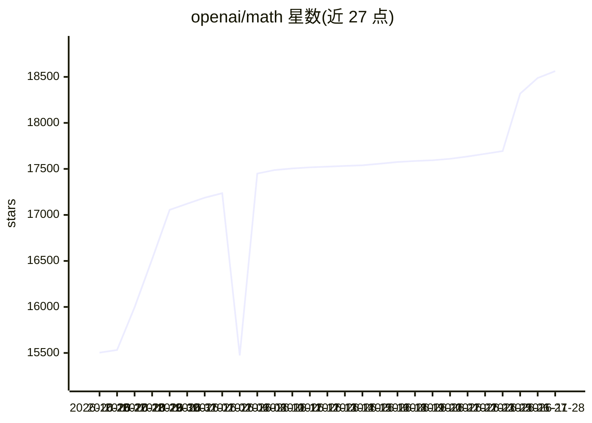

# openai/math

⭐ 18,563 · Lean · Apache-2.0 · 推送 2026-11-25 · [GitHub](https://github.com/openai/math) · 组织维护

**OpenAI 内部模型生成的数学手稿与形式化证明合集**

该仓库收录由 OpenAI 未发布内部模型产出的数学手稿及配套证明材料：730 份手稿按学科分类组织为 375 个族，约 42% 的顶线结果配有 Lean 形式化证明，preprints/ 目录提供 PDF、源文件与构建说明，另附部分结果的推理摘要。README 说明结果通过约 4,000 个开放研究问题的评估产生，材料定位为原始研究数据而非成稿论文，且验证状态分级标注、持续更新形式化内容。

## 筛选速览

| 维度 | 判定 | 备注 |
|---|---|---|
| AI 角色 | `ai-knowledge` | 知识聚合/清单类 |
| 许可风险 | `permissive` | Apache-2.0 |
| 部署形态 | `None` |  |
| 模型依赖 | — | README 未给出锁定关系 |
| 硬件要求 | — | 无带数字的原话,不猜 |
| 安装摩擦 | `low` | 无编译、无系统依赖或容器化 |
| 成熟度 | — | 结构信号不足 |

## 动量与使用信号

- 维护:`active` — 距上次 push 5.5 天,年发版 0,3 位贡献者
- 涨星:近 1 天 **+102**(自 20261016 起算)

## 能力要点

- 730 份手稿组织为 375 个按数学学科分类的族
- 约 42% 顶线结果已有 Lean 形式化证明
- 提供手稿地图、族概览与 BibTeX 引用信息
- 公开版本历史保留，修订以新版本发布

## 适用场景

- 查找特定数学分支的模型生成证明材料
- 为手稿中的结果核对 Lean 形式化状态
- 按 BibTeX 引用个别手稿用于研究

## 场景标签

`科研工具` · 领域:学习与行业

## 证据(README 行号)

> L3: This repository contains mathematical manuscripts and supporting proof artifacts produced by an unnamed internal Ope
> L16: The current catalogue contains 730 manuscripts organized into 375 families. A family groups related papers, which m
> L21: - The Lean library and formalization catalogue describe the available formal proofs, their associated papers, and v

## 星数曲线

2026-10-26 15,503 → 2026-11-28 18,563（+3,060）

---
*卡片 v1 · prompt 1.4 · 生成 2026-11-26 · 置信度 high · 依据 README sha `927a4d7e55da` · [字段定义](../../DATASET.md)*
