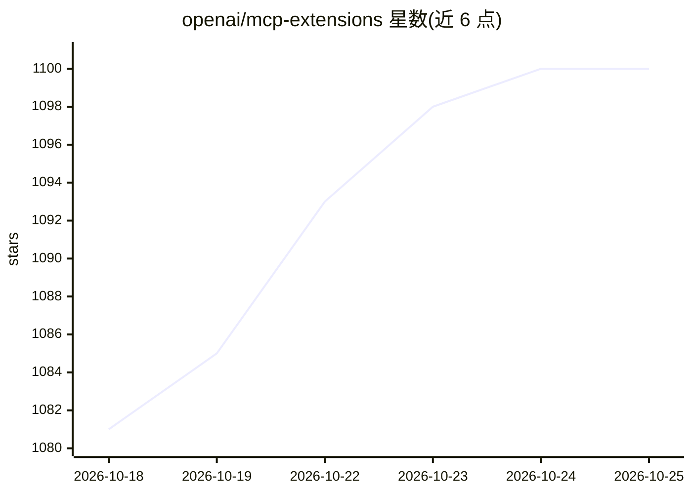

# openai/mcp-extensions

⭐ 1,106 · TypeScript · Apache-2.0 · 推送 2026-10-22 · [GitHub](https://github.com/openai/mcp-extensions) · 组织维护

**为 ChatGPT 构建 MCP 插件扩展的 SDK，含侧边栏入口、文件查看器等能力**

OpenAI 官方的 MCP Extensions 项目：在 MCP 协议之上添加 ChatGPT 专属能力，使开发者能构建像原生功能一样的插件。支持的扩展包括侧边栏入口、自定义文件查看器、Composer 内资源提及、含缩略图选择的扩展表单。提供 TypeScript（@openai/mcp-extensions）与 Python（openai-mcp-extensions）SDK，配合 docs/spec.md、patterns.md 与 Bits & Bolts 示例源码使用；插件构建可借助 Codex 中的 @Plugin Creator。Apache 2.0 许可。

## 筛选速览

| 维度 | 判定 | 备注 |
|---|---|---|
| AI 角色 | `ai-ecosystem` | LLM/agent 周边工具 |
| 许可风险 | `permissive` | Apache-2.0 |
| 部署形态 | `None` |  |
| 模型依赖 | — | README 未给出锁定关系 |
| 硬件要求 | — | 无带数字的原话,不猜 |
| 安装摩擦 | `low` | 无编译、无系统依赖或容器化 |
| 成熟度 | — | 结构信号不足 |

## 能力要点

- 为 MCP 添加 ChatGPT 专属扩展能力（侧边栏入口、文件处理器、composer 提及、扩展表单）
- 提供 TypeScript 与 Python SDK
- 附带规范文档、模式指南与 Bits & Bolts 实例源码

## 适用场景

- 为自己的 MCP 插件添加 ChatGPT 原生感 UI 扩展
- 让用户从 ChatGPT 侧边栏直接打开我的应用
- 在 Composer 中让用户搜索并引用插件资源

## 场景标签

 · 领域:LLM 基础设施/插件开发

## 证据(README 行号)

> L3: OpenAI MCP Extensions adds ChatGPT-specific capabilities to MCP so developers can build plugins that feel like nativ
> L47: - TypeScript: `@openai/mcp-extensions` for MCP servers and Apps.
> L48: - Python: `openai-mcp-extensions` for MCP servers.

## 星数曲线

2026-10-18 1,081 → 2026-10-25 1,100（+19）

---
*卡片 v1 · prompt 1.4 · 生成 2026-10-21 · 置信度 high · 依据 README sha `d2e050d6ea85` · [字段定义](../../DATASET.md)*
