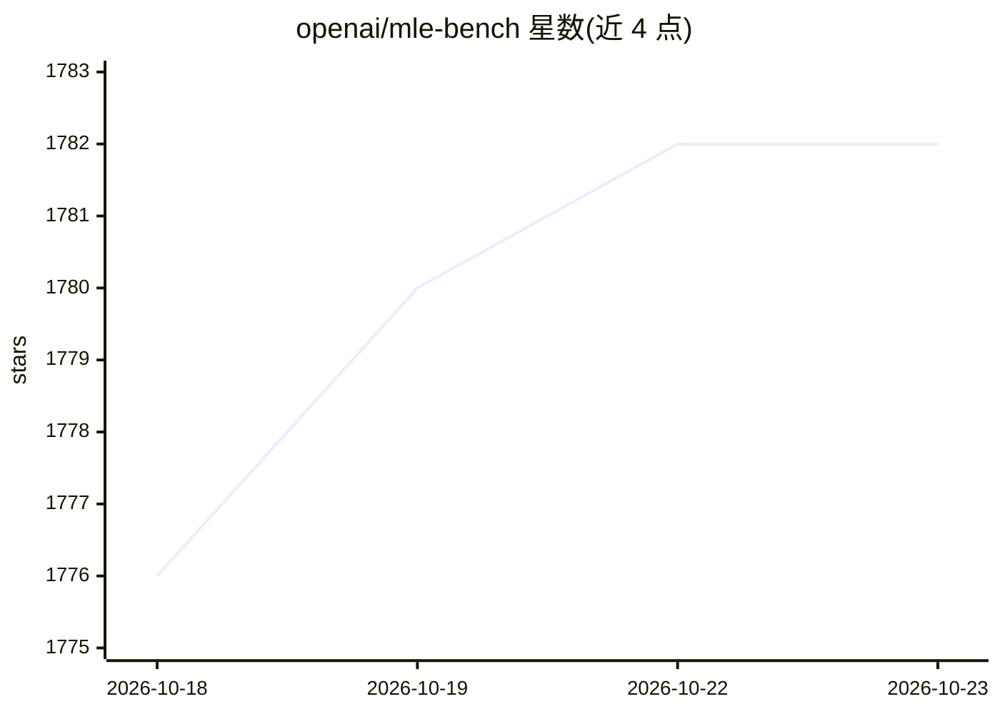

# openai/mle-bench

⭐ 1,782 · Python · NOASSERTION · 推送 2026-04-24 · [GitHub](https://github.com/openai/mle-bench) · [官网](https://openai.com/index/mle-bench/) · 组织维护

**评测 AI agent 机器学习工程能力的基准（75 个 Kaggle 竞赛）**

OpenAI 发布的论文配套代码，构建于 75 个 Kaggle 竞赛数据集之上，用于评测 AI agent 完成机器学习工程任务的表现。提供数据集构建脚本（将公开训练集重新切分为训练/测试集）、评分脚本与 CLI（mlebench prepare/grade）、用于运行 agent 的基础 Docker 镜像（含 Conda 环境与评分服务器），以及论文中评测过的 agent。提供 22 个竞赛的 Lite 版本（数据量 158GB，全集 3.3TB）；数据准备从头运行约需两天。维护公开排行榜，目前暂停接收新提交。

## 筛选速览

| 维度 | 判定 | 备注 |
|---|---|---|
| AI 角色 | `ai-ecosystem` | LLM/agent 周边工具 |
| 许可风险 | `none` | NOASSERTION |
| 部署形态 | `self-host` | docker 或自建部署 |
| 模型依赖 | — | README 未给出锁定关系 |
| 硬件要求 | — | 无带数字的原话,不猜 |
| 安装摩擦 | `low` | 无编译、无系统依赖或容器化 |
| 成熟度 | — | 结构信号不足 |

## 能力要点

- 75 个 Kaggle 竞赛构成评测数据集，附切分与评分脚本
- mlebench CLI 支持 prepare/grade/grade-sample 命令
- 提供 mlebench-env 基础 Docker 镜像（Conda 环境+评分服务器）
- Lite 版本含 22 个低复杂度竞赛，数据量 158GB

## 适用场景

- 评测自研 ML agent 的工程能力并与排行榜对比
- 用低复杂度子集做低成本的 agent 评测
- 为 Kaggle 风格 ML 任务生成可评分的测试环境

## 场景标签

`模型评测` · 领域:评测与运维

## 证据(README 行号)

> L3: Code for the paper "MLE-Bench: Evaluating Machine Learning Agents on Machine Learning Engineering". We have released
> L136: The MLE-bench dataset is a collection of 75 Kaggle competitions which we use to evaluate the ML engineering capabi

## 星数曲线

2026-10-18 1,776 → 2026-10-23 1,782（+6）

---
*卡片 v1 · prompt 1.4 · 生成 2026-10-21 · 置信度 high · 依据 README sha `e8bf8c73c288` · [字段定义](../../DATASET.md)*
