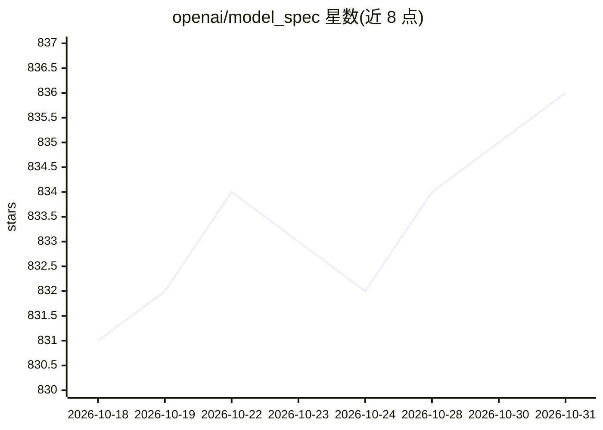

# openai/model_spec

⭐ 836 · CC0-1.0 · 推送 2026-10-29 · [GitHub](https://github.com/openai/model_spec) · [官网](https://model-spec.openai.com/) · 组织维护

**OpenAI 模型行为规范文档：模型期望行为的官方规约来源**

OpenAI 官方仓库，存放 Model Spec 的 Markdown 源文件及历次已发布版本的 HTML 归档（自 2025-02-12 第二次发布起）。Model Spec 规定 OpenAI 产品（含 API）底层模型的期望行为，属于文档型仓库而非可运行软件，无安装或运行流程。内容以 CC0 1.0 声明进入公有领域，人类可读版本发布于 model-spec.openai.com，并附带博客介绍与发布说明链接。

## 筛选速览

| 维度 | 判定 | 备注 |
|---|---|---|
| AI 角色 | `ai-knowledge` | 知识聚合/清单类 |
| 许可风险 | `viral` | CC0-1.0 |
| 部署形态 | `None` |  |
| 模型依赖 | — | README 未给出锁定关系 |
| 硬件要求 | — | 无带数字的原话,不猜 |
| 安装摩擦 | `low` | 无编译、无系统依赖或容器化 |
| 成熟度 | — | 结构信号不足 |

## 能力要点

- 存放 Model Spec 的 Markdown 源文件
- 归档 2025-02-12 起各已发布版本的 HTML 版本
- 以 CC0 1.0 声明进入公有领域

## 适用场景

- 查阅 OpenAI 对模型期望行为的官方规约
- 对比历次版本的 Model Spec 变更
- 作为模型行为规范类工作的参考文档

## 场景标签

 · 领域:AI 治理/模型规范

## 证据(README 行号)

> L3: The Model Spec specifies desired behavior for the models underlying OpenAI's products (including our APIs).
> L9: This repository contains the markdown source for the Model Spec and an archive of all released

## 星数曲线

2026-10-18 831 → 2026-10-31 836（+5）

---
*卡片 v1 · prompt 1.4 · 生成 2026-10-21 · 置信度 high · 依据 README sha `a68a1ceb2920` · [字段定义](../../DATASET.md)*
