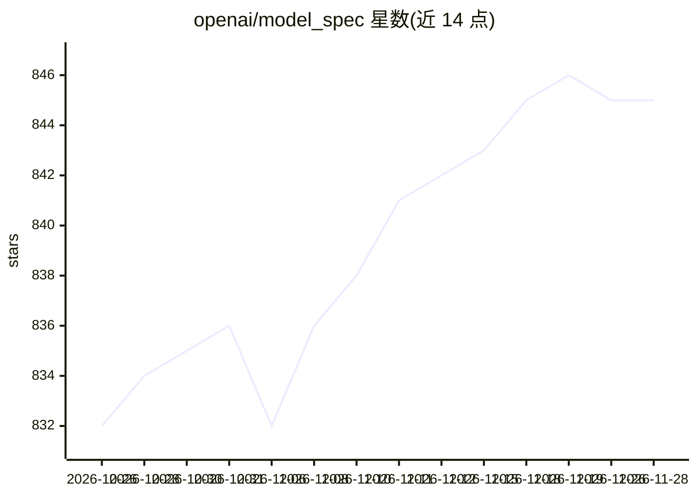

# openai/model_spec

⭐ 845 · CC0-1.0 · 推送 2026-11-12 · [GitHub](https://github.com/openai/model_spec) · [官网](https://model-spec.openai.com/) · 组织维护

**OpenAI 模型行为规范的公开文档仓库**

存放 OpenAI Model Spec 的 Markdown 源文件及已发布 HTML 版本存档，规范定义其产品（含 API）底层模型的期望行为。仓库提供最新规范的阅读链接、更新日志及方法说明文档。许可为公共领域（CC0 1.0）。本仓库为文档而非可运行软件，README 未提供安装或运行说明。

## 筛选速览

| 维度 | 判定 | 备注 |
|---|---|---|
| AI 角色 | `ai-knowledge` | 知识聚合/清单类 |
| 许可风险 | `viral` | CC0-1.0 |
| 部署形态 | `None` |  |
| 模型依赖 | — | README 未给出锁定关系 |
| 硬件要求 | — | 无带数字的原话,不猜 |
| 安装摩擦 | `low` | 无编译、无系统依赖或容器化 |
| 成熟度 | — | 结构信号不足 |

## 能力要点

- Model Spec 的 Markdown 源文件与历史 HTML 版本存档
- 规范以 CC0 1.0 公共领域许可发布
- 提供最新版本阅读站点与更新日志入口

## 适用场景

- 查阅 OpenAI 模型行为规范的内容与历史版本
- 跟踪 Model Spec 的更新与变更记录

## 场景标签

 · 领域:AI 治理/规范文档

## 证据(README 行号)

> L3: The Model Spec specifies desired behavior for the models underlying OpenAI's products (including our APIs).
> L10: This repository contains the Markdown source for the Model Spec,
> L11: together with an archive of released Model Spec

## 星数曲线

2026-10-26 832 → 2026-11-28 845（+13）

---
*卡片 v1 · prompt 1.4 · 生成 2026-11-24 · 置信度 high · 依据 README sha `ef1459e90585` · [字段定义](../../DATASET.md)*
