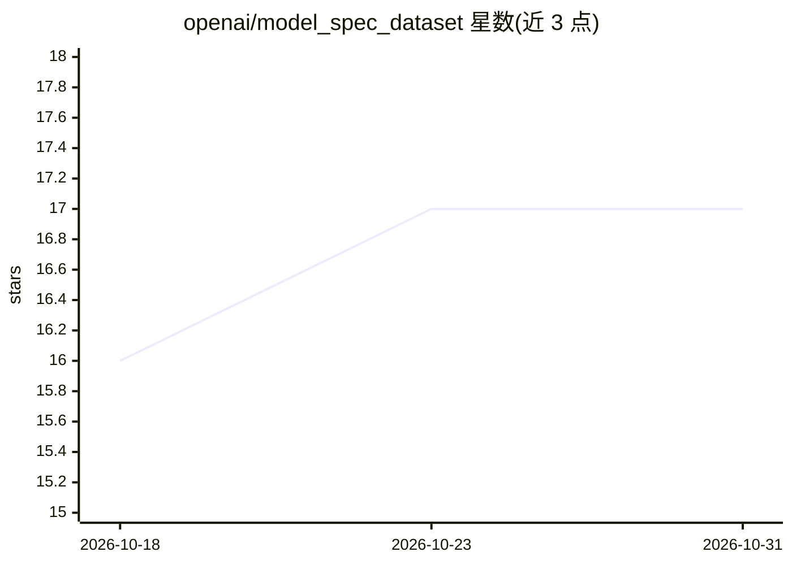

# openai/model_spec_dataset

⭐ 17 · CC0-1.0 · 推送 2026-03-24 · [GitHub](https://github.com/openai/model_spec_dataset) · 组织维护

**评估 OpenAI Model Spec 合规性的公开提示词数据集**

OpenAI 发布的公有领域数据集，包含 596 条提示词与场景，用于评估模型对 2025-12-18 版 OpenAI Model Spec 的合规性。每条提示附元数据：target（评分要点/合规判据）、focus_id（对应 model_spec.md 中的焦点条目）、section_id 与 sections（所属章节链）、skip 标记（9 条含 system 消息的提示无法经公开 API 运行，会被跳过）。数据集设计为配合 Model Spec Eval harness 使用，本身不含运行代码。

## 筛选速览

| 维度 | 判定 | 备注 |
|---|---|---|
| AI 角色 | `ai-knowledge` | 知识聚合/清单类 |
| 许可风险 | `viral` | CC0-1.0 |
| 部署形态 | `None` |  |
| 模型依赖 | — | README 未给出锁定关系 |
| 硬件要求 | — | 无带数字的原话,不猜 |
| 安装摩擦 | `low` | 无编译、无系统依赖或容器化 |
| 成熟度 | — | 结构信号不足 |

## 能力要点

- 596 条提示词，公有领域发布
- 每条提示含 target 评分判据与 focus_id/section 章节溯源元数据
- 标注 9 条因 system 消息限制需跳过的提示
- 配套 Model Spec Eval harness 使用

## 适用场景

- 配合 Model Spec Eval harness 评估模型合规性
- 研究 Model Spec 各焦点条目对应的测试覆盖
- 构建或扩展模型行为对齐评测集

## 场景标签

`模型评测` · 领域:评测与运维

## 证据(README 行号)

> L1: # OpenAI Model Spec Eval Dataset
> L2: A public-domain dataset of prompts and scenarios for evaluating compliance with the OpenAI Model Spec as of 2025-12-
> L4: This dataset is intended to be run with the Model Spec Eval harness.

## 星数曲线

2026-10-18 16 → 2026-10-31 17（+1）

---
*卡片 v1 · prompt 1.4 · 生成 2026-10-29 · 置信度 high · 依据 README sha `8ac762425bcb` · [字段定义](../../DATASET.md)*
